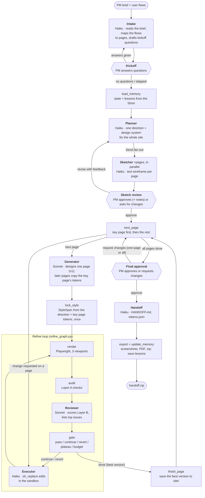

# UI Agent — prototype

You brief it like a PM briefs a UI/UX designer: the problem and at least one user flow (a paragraph on what a user does, start to finish), never the pages, colors, fonts or layout. The designer agent works out the users and the pages the flows need (up to 6), may ask a few kickoff questions, then proposes one direction for the whole site (a design system) with a low-fidelity sketch of every page. You approve it or ask for changes. The first page of flow 1 is designed in full and sets the design system; every other page is designed against it with the same tokens, header and footer, and each page goes through a reviewer/executor loop against a rubric. Pages link to each other, so the result is a clickable prototype, and you get a handoff package (one HTML file per page, `tokens.json`, `FLOWS.md`, `HANDOFF.md`, screenshots, PDFs) for a coding agent. See `plan.md` for the full design.

## How the agents work together

Each LLM role is its own agent with its own prompt and model (set in `config.yaml`). They share one LangGraph state and never call each other directly; the graph passes the state from one to the next. Rounded boxes are LLM agents, square boxes run code only, and hexagons pause the run for the PM.



The fan-out runs at most `max_parallel_generations` sketchers at once. The refine loop runs once per page, with its own issues and versions under `pages/<id>/`; the key page gets `max_iterations` rounds and the others `max_iterations_secondary`. The gate always carries forward the best-scoring version, so a revert or a stop never loses ground. Change requests from final approval go back to the chosen pages' refine loops at the executor, then through review again. A page past the cost budget is skipped and listed at final review.

## Why not just use Claude Design?

Claude Design turns a prompt into a design. This project adds two things it doesn't do:

1. **It follows the real PM → designer workflow.** You describe the problem, not the visuals. The designer agent asks kickoff questions the way a designer would at a kickoff meeting, then works out which pages your flows need and sketches every one of them in one direction for you to approve before anything is designed in full. This gets you closer to what a PM actually needs than writing one detailed visual prompt and iterating on whatever comes back.
2. **It critiques its own work against a fixed UI/UX rubric.** Each version is rendered and scored against `rubric/rubric.yaml`. Layer A runs automated pass/fail checks: accessibility, contrast, overflow, tap-target size, font-size floor, console errors, focus visibility, and design-token use, flow links (A11: every flow step links to its next page, and no link points at a page the site doesn't have), plus three warnings: layout balance (A9) flags a short column leaving a big empty area beside a tall one, AI-template tells (A10) runs [impeccable](https://github.com/pbakaus/impeccable)'s detector for habits like a tiny label above the headline or an icon tile above every card heading, and text scaling (A12) doubles the text size at 1440px and checks the page still fits. Layer B scores the page against anchored criteria for UI/UX design principles: hierarchy, layout and spacing, typography, color, responsiveness, component consistency, fit with the brief, interaction states, fidelity to the chosen direction, and design specificity (could an unrelated product use the page unchanged?). A reviewer/executor loop fixes what fails, and a gate keeps the best version. The result is held to an explicit standard instead of depending on how good a single generation happens to be.

## Run it

Requirements: Python ≥ 3.11, Node ≥ 20.

```bash
# Backend (FastAPI + LangGraph + Playwright)
python3 -m venv .venv
.venv/bin/pip install -e ".[dev]"
.venv/bin/python -m playwright install chromium
npm install -g impeccable               # optional: enables the A10 check (skipped without it)

export ANTHROPIC_API_KEY=...            # real mode (Claude Sonnet 5.5 for every role, see config.yaml)
# or: export UI_AGENT_MOCK=1            # offline mode: no API calls, deterministic stand-ins
.venv/bin/uvicorn ui_agent.api.app:app --port 8000

# Frontend (Next.js)
cd frontend && npm install && npm run dev   # http://localhost:3000
```

`NEXT_PUBLIC_API_URL` overrides the backend URL (default `http://localhost:8000`).

**Mock mode** (`UI_AGENT_MOCK=1`) runs the real pipeline end to end: real rendering, real Layer-A audits, real gate logic, and real `str_replace` edits through the sandboxed editor. Only the LLM calls are replaced. The mock designer finds pages in the flows by keyword (post, pricing, sign up, sign in, dashboard) and asks one kickoff question when the brief has no audience. Generated pages contain seeded defects (missing focus states, small tap targets, 11px text, hard-coded values, a weak CTA), so you can watch the loop find and fix them.

## Dev tools and tests

```bash
.venv/bin/python scripts/audit.py page.html                       # Layer-A report for one file
.venv/bin/python scripts/refine.py page.html --problem "…" --audience "…"   # refine loop only
.venv/bin/python -m pytest -q                                     # presets CI, M0 checks, units, full mock pipeline (multi-page)
.venv/bin/python scripts/eval.py run --label <name>               # full pipeline on the 5 fixed briefs in evals/briefs.yaml (~$0.50 each)
.venv/bin/python scripts/eval.py compare evals/results/<a> evals/results/<b>
.venv/bin/python scripts/replay_executor.py --label <name> runs/<id> …   # executor only, on recorded refine rounds (cents)
```

## Layout

```
presets/            the designer's library: styles (with build recipes), layouts, page structures, industries, colors (OKLCH ranges
                    + AA-validated examples), typography, options; much of it adapted from ui-ux-pro-max (THIRD_PARTY.md)
config.yaml         role → model/effort, thresholds, viewports, budget
rubric/rubric.yaml  Layer A gates + Layer B anchored criteria and weights
prompts/            intake, planner, sketcher (+ sketch_contract: the text-wireframe format), generator, html_contract, reviewer, executor, handoff
src/ui_agent/
  graph.py          top-level graph (plan §3.1)        refine_graph.py  refine-loop subgraph
  llm.py            the one Claude wrapper             mock.py          offline stand-ins
  library.py        industry priors + a per-run sample of the presets for the planner
  nodes/            intake (+ kickoff, site map), planner, sketch, pages (sketch review, page loop), generator (design_page), style_lock,
                    reviewer, gate, executor, final_approval, handoff
  tools/            browser.py (Playwright, tiles, DOM facts), checks/ (A1–A12), text_editor.py (sandbox)
  memory/store.py   taste / lessons / runs on the LangGraph Store (SQLite)
  api/              FastAPI app + run manager (SSE with replay)
frontend/           Brief (with flows), Kickoff, Sketching, Review sketches, Designing & refining (per page), Final review (page tabs), Download, Runs, Memory
runs/<id>/          sketches/<page>.txt, pages/<page>/ (vN.html, shots, review JSON), site/ (best page versions, linked),
                    output/ (handoff), handoff.zip, events.jsonl
```

## What the prototype covers, and what it simplifies

Implemented as planned:
- The whole graph: `Send` fan-out with a parallelism cap, all three interrupts (kickoff questions, sketch review, final approval), SQLite checkpointer (runs resume after a page reload), and SQLite Store memory.
- A code-checked site map: at most 6 pages with the entry page of flow 1 first, unique ids and file names, flow steps on real pages, and a link for every step that changes page. One direction with contrast repair; the planner sees industry priors for the brief and a fresh sample of the library each run. The key page's tokens are copied into every other page by code, after generation and after every executor edit. The gate does pass, revert-to-best, plateau, max iterations and budget, and always outputs the best version.
- The Claude call shape from §10: structured outputs, adaptive thinking with per-role effort, streaming, a cached system prefix, `fallbacks: "default"`, refusal and max-token handling, and per-node usage and cost tracking.
- The Brief screen (problem and one to five user flows, plus optional name and context; intake infers the users and the pages), kickoff questions with one-click suggested answers, a sketch review (the direction's concept and style tile, the flows mapped onto pages, and a tab per page sketch), and a final review where the previews are live and linked, with change requests for one page or all of them.

Simplified or not yet built:
- **A6** checks console/page errors plus document basics (doctype, `lang`, viewport). `html-validate` is not wired in yet.
- **Not built:** the evals (§13), tracing (LangSmith/Langfuse), the project brand-kit UI (the Store namespace exists), Postgres, and the MCP server.
- **Refine subgraph:** a compiled subgraph used directly as a node would write its whole output back through the parent's reducers and double-count `history` and `usage`. So it runs inside a wrapper node that returns only its changes.
- **Real mode is untested against the live API** in this environment (no key was available). Request payloads for every role were checked against a local stub server. Expect prompt tuning once real runs happen.
