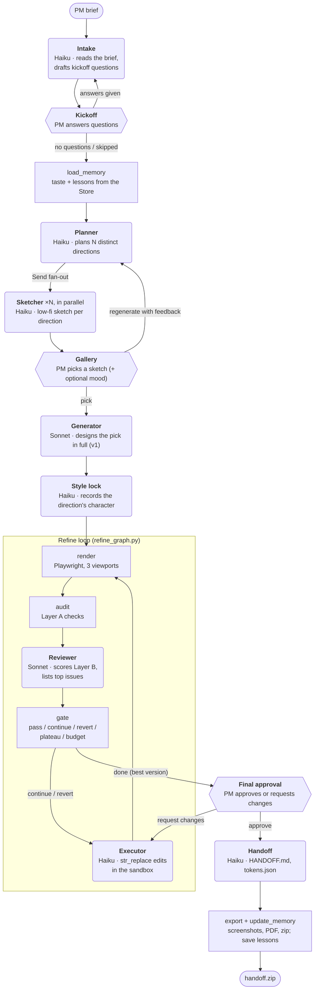

# UI Agent — prototype

You brief it like a PM briefs a UI/UX designer: the problem (the designer works out the users), never the colors, fonts or layout. The designer agent may ask a few kickoff questions, then sketches N low-fidelity directions (default 3), each a different bet on solving the problem with a proposed visual mood. You pick a layout and, separately, a design system; the pair is designed in full, then a reviewer/executor loop refines it against a rubric, and you get a handoff package (`index.html`, `tokens.json`, `HANDOFF.md`, screenshots, PDF) for a coding agent. See `plan.md` for the full design.

## How the agents work together

Each LLM role is its own agent with its own prompt and model (set in `config.yaml`). They share one LangGraph state and never call each other directly; the graph passes the state from one to the next. Rounded boxes are LLM agents, square boxes run code only, and hexagons pause the run for the PM.



The fan-out runs at most `max_parallel_generations` sketchers at once. The gate always carries forward the best-scoring version, so a revert or a stop never loses ground. Change requests from final approval enter the refine loop at the executor, then go through review again.

## Why not just use Claude Design?

Claude Design turns a prompt into a design. This project adds two things it doesn't do:

1. **It follows the real PM → designer workflow.** You describe the problem, not the visuals. The designer agent asks kickoff questions the way a designer would at a kickoff meeting, then offers several competing directions for you to choose from before anything is designed in full. This gets you closer to what a PM actually needs than writing one detailed visual prompt and iterating on whatever comes back.
2. **It critiques its own work against a fixed UI/UX rubric.** Each version is rendered and scored against `rubric/rubric.yaml`. Layer A runs automated pass/fail checks: accessibility, contrast, overflow, tap-target size, font-size floor, console errors, focus visibility, and design-token use, plus a layout-balance warning (A9) that flags a short column leaving a big empty area beside a tall one. Layer B scores the page against anchored criteria for UI/UX design principles: hierarchy, layout and spacing, typography, color, responsiveness, component consistency, fit with the brief, interaction states, and fidelity to the chosen direction. A reviewer/executor loop fixes what fails, and a gate keeps the best version. The result is held to an explicit standard instead of depending on how good a single generation happens to be.

## Run it

Requirements: Python ≥ 3.11, Node ≥ 20.

```bash
# Backend (FastAPI + LangGraph + Playwright)
python3 -m venv .venv
.venv/bin/pip install -e ".[dev]"
.venv/bin/python -m playwright install chromium

export ANTHROPIC_API_KEY=...            # real mode (Claude Sonnet 5.5 for every role, see config.yaml)
# or: export UI_AGENT_MOCK=1            # offline mode: no API calls, deterministic stand-ins
.venv/bin/uvicorn ui_agent.api.app:app --port 8000

# Frontend (Next.js)
cd frontend && npm install && npm run dev   # http://localhost:3000
```

`NEXT_PUBLIC_API_URL` overrides the backend URL (default `http://localhost:8000`).

**Mock mode** (`UI_AGENT_MOCK=1`) runs the real pipeline end to end: real rendering, real Layer-A audits, real gate logic, and real `str_replace` edits through the sandboxed editor. Only the LLM calls are replaced. The mock designer asks one kickoff question when the brief has no goal. Generated pages contain seeded defects (missing focus states, small tap targets, 11px text, hard-coded values, a weak CTA), so you can watch the loop find and fix them.

## Dev tools and tests

```bash
.venv/bin/python scripts/audit.py page.html                       # Layer-A report for one file
.venv/bin/python scripts/refine.py page.html --problem "…" --audience "…"   # refine loop only
.venv/bin/python -m pytest -q                                     # 37 tests: presets CI, M0 checks, units, full mock pipeline
.venv/bin/python scripts/eval.py run --label <name>               # full pipeline on the 5 fixed briefs in evals/briefs.yaml (~$0.50 each)
.venv/bin/python scripts/eval.py compare evals/results/<a> evals/results/<b>
.venv/bin/python scripts/replay_executor.py --label <name> runs/<id> …   # executor only, on recorded refine rounds (cents)
```

## Layout

```
presets/            the designer's library: styles (with build recipes), layouts, page structures, industries, colors (OKLCH ranges
                    + AA-validated examples), typography, options; much of it adapted from ui-ux-pro-max (THIRD_PARTY.md)
config.yaml         role → model/effort, thresholds, viewports, budget
rubric/rubric.yaml  Layer A gates + Layer B anchored criteria and weights
prompts/            intake, planner, sketcher (+ sketch_contract, sketch_kit.css), generator, html_contract, style_lock, reviewer, executor, handoff
src/ui_agent/
  graph.py          top-level graph (plan §3.1)        refine_graph.py  refine-loop subgraph
  llm.py            the one Claude wrapper             mock.py          offline stand-ins
  library.py        industry priors + a per-run sample of the presets for the planner
  nodes/            intake (+ kickoff), planner, sketch, gallery, generator (design), style_lock, reviewer, gate, executor, final_approval, handoff
  tools/            browser.py (Playwright, tiles, DOM facts), checks/ (A1–A8), text_editor.py (sandbox)
  memory/store.py   taste / lessons / runs on the LangGraph Store (SQLite)
  api/              FastAPI app + run manager (SSE with replay)
frontend/           Brief, Kickoff, Sketching, Pick a sketch, Designing & refining, Final review, Download, Runs, Memory
runs/<id>/          sketches/, refine/ (vN.html, shots, review JSON), output/ (handoff), handoff.zip, events.jsonl
```

## What the prototype covers, and what it simplifies

Implemented as planned:
- The whole graph: `Send` fan-out with a parallelism cap, all three interrupts (kickoff questions, sketch pick, final approval), SQLite checkpointer (runs resume after a page reload), and SQLite Store memory.
- Code-enforced direction diversity (concept, layout, type, palette, density, style, section order, theme, variance; no font family, library style or page structure shared between directions) and contrast repair. The planner sees industry priors for the brief and a fresh sample of the library each run, and the slots (taste, neutral, bold, wildcard) never put two safe directions side by side. The gate does pass, revert-to-best, plateau, max iterations and budget, and always outputs the best version.
- The Claude call shape from §10: structured outputs, adaptive thinking with per-role effort, streaming, a cached system prefix, `fallbacks: "default"`, refusal and max-token handling, and per-node usage and cost tracking.
- The Brief screen (problem, plus optional name, goal and context; intake infers the users), kickoff questions with one-click suggested answers, and a gallery with two independent choices: a layout (each sketch's concept, trade-off and structure) and a design system (each direction's style tile: a hero sample, a card and the palette in its fonts and colors). Any layout can be designed with any design system.

Simplified or not yet built:
- **A6** checks console/page errors plus document basics (doctype, `lang`, viewport). `html-validate` is not wired in yet.
- **Not built:** the evals (§13), tracing (LangSmith/Langfuse), the project brand-kit UI (the Store namespace exists), Postgres, and the MCP server.
- **Refine subgraph:** a compiled subgraph used directly as a node would write its whole output back through the parent's reducers and double-count `history` and `usage`. So it runs inside a wrapper node that returns only its changes.
- **Real mode is untested against the live API** in this environment (no key was available). Request payloads for every role were checked against a local stub server. Expect prompt tuning once real runs happen.
