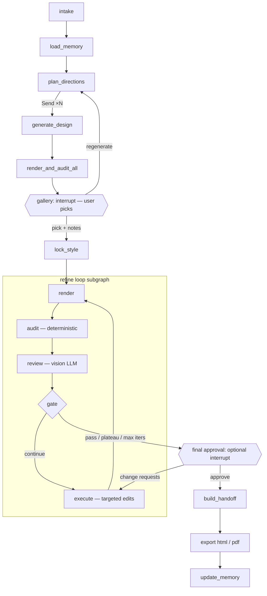

# UI Agent — Project Plan

An agent that turns a prompt into a production-ready **web page UI** (HTML/CSS), built for **developers**. It explores several design directions, lets the user pick one, then refines it through a reviewer ↔ executor loop until it meets a quality bar. The output is a **handoff package** that another coding agent (e.g. Claude Code) uses as the source of truth to build the real project. The design is created **before any codebase exists**.

---

## 1. Goals and non-goals

**Goals**
- Generate visually distinct directions from one prompt, in parallel. The user chooses how many (default 3, range 1–10).
- Let the user choose a direction (plus optional notes).
- Automatically refine the chosen design against an explicit UI/UX rubric, with screenshots, until it passes a threshold.
- Output HTML that is easy for a coding agent to integrate: semantic markup, tokenized CSS, labeled components, and a written handoff spec.
- Learn the user's taste and the system's recurring mistakes across runs (long-term memory).

**Non-goals (v1)**
- Multi-page apps or flows. One page per run.
- Framework output (React/Vue/Tailwind). The coding agent translates; we give it clean, framework-agnostic input.
- Matching an existing codebase or design system. This tool makes the *initial* design, before any code exists. (Explicit brand constraints the user types in, like colors or fonts, are still supported.)
- Real imagery or brand assets. We use annotated placeholders.
- A hosted multi-user SaaS. v1 is a single-user web app (frontend + Python backend) run locally.

---

## 2. Key decisions

| Decision | Choice | Why |
|---|---|---|
| Orchestration | **LangGraph** (Python) | It has the primitives this flow needs: `Send` for the N-way fan-out, `interrupt()` for the human pick, a checkpointer for pause/resume, and `Store` for long-term memory. |
| Control flow | **Deterministic graph; LLMs only inside nodes** | The pipeline is fixed. Code owns routing, stop conditions and retries, so runs are debuggable, resumable and cheaper. |
| LLM access | **Anthropic Python SDK called directly inside nodes** | Gives access to current API features (structured outputs via `messages.parse`, adaptive thinking, effort, refusal fallbacks, prompt caching) without waiting for wrapper support. |
| Model | `claude-sonnet-5-5` for every LLM role (configurable per role in `config.yaml`) | Cost efficiency: half the per-token price of Opus 5.5 ($2 / $10 vs. $4 / $20 per million input/output tokens), which matters with up to 10 generations plus the refine loop per run. Each role is configurable, so a role that falls short on the eval suite (most likely the reviewer or planner) can be moved to `claude-opus-5-5` without touching code. |
| Output format | Single-file HTML + CSS custom properties + `data-component` labels + `HANDOFF.md` + `tokens.json` | The consumer is a coding agent. Structure and a written spec matter more than pixel-perfect files. |
| Styling | **Plain CSS** (no Tailwind or other CSS framework) | Keeps the most design detail: exact values, complex selectors, pseudo-elements, layered gradients, keyframes, `clamp()` type scales, and named tokens. Utility classes compress or hide this, and arbitrary values get messy. The downstream agent can always convert plain CSS to Tailwind later; converting the other way loses information. |
| Starting point | **Greenfield**: no existing codebase | The design comes first and the codebase is built from it, so there's no repo to read or match. |
| Interface | **Web frontend** (Next.js + TypeScript) talking to a Python backend | The users are developers without design training. Choices have to be *shown*, not named, so every option gets a live sample next to it. The gallery, refinement progress and before/after comparison are visual too. An MCP server comes later. |
| Design preferences | **Curated presets with live samples**, all optional | Developers choose the look; the agent handles the craft (§5). |
| Review | **Two layers**: deterministic audits (code) + rubric judgment (vision LLM) | Objective checks can't be argued with or hallucinated, and the LLM focuses on what needs judgment. |
| PDF | Optional visual snapshot only | Developers integrate the HTML; a PDF is just for sharing or sign-off. |

---

## 3. Architecture

### 3.1 Graph



### 3.2 State (sketch)

```python
class DirectionBrief(BaseModel):
    id: str
    name: str                    # e.g. "Editorial Calm"
    reference_style: str         # Swiss / editorial / brutalist / playful / dense-dashboard ...
    layout_archetype: str        # LayoutId if the user picked layouts (§5.2), else planner's choice, e.g. "asymmetric split hero + bento grid"
    type_pairing: tuple[str, str]
    palette: dict[str, str]      # role -> hex, composed by the planner within the chosen color direction (§5.2)
    density: Literal["airy", "balanced", "dense"]
    signature_element: str       # the one memorable thing
    avoid: list[str]

class Design(BaseModel):
    direction_id: str
    version: int
    html_path: str
    screenshots: dict[str, str]  # "mobile"/"tablet"/"desktop" -> png path
    audit: AuditResult | None
    review: ReviewResult | None
    score: float | None

class AgentState(TypedDict):
    run_id: str
    user_id: str
    prompt: str
    preferences: DesignPreferences                       # from the setup screen (§5)
    candidate_count: int                                 # 1–10, default 3 (§5.5)
    memory_context: dict
    briefs: list[DirectionBrief]
    candidates: Annotated[list[Design], operator.add]   # fan-out reducer
    selection: Selection | None                          # chosen id + user notes
    style_lock: StyleSpec | None
    current: Design | None
    best: Design | None
    history: list[Design]
    iteration: int
    resolved_issue_ids: list[str]
    stop_reason: str | None
    usage: TokenUsage                                    # running cost tracking
```

Checkpointer: SQLite locally (Postgres later). Each run is one `thread_id`, so a run can stop at the gallery and resume hours later.

### 3.3 System components

```
Next.js frontend  ⇄  FastAPI backend  →  LangGraph run (background task)  →  Playwright / Anthropic API
                      │                                                    
                      └─ serves run artifacts (HTML, screenshots, zip, PDF)
```

**Backend API** (FastAPI wrapping the compiled graph):

| Endpoint | Purpose |
|---|---|
| `GET /presets` | Preset catalog for the setup screen (§5.4) |
| `POST /runs` | Start a run with `prompt` + `DesignPreferences` + `candidate_count` → `run_id` |
| `GET /runs/{id}/events` | Server-sent events (SSE) stream: node started/finished, each candidate ready, each refine iteration (screenshot, score, issues), interrupts |
| `POST /runs/{id}/resume` | Answer an interrupt (gallery pick / regenerate / final approval) → `Command(resume=...)` |
| `GET /runs/{id}/artifacts/...` | Candidate HTML (shown in sandboxed iframes), screenshots, handoff zip, PDF |
| `GET/PUT/DELETE /memory` | View, edit and reset remembered preferences |

The graph streams progress through LangGraph's custom stream mode, which the API relays as SSE. (Alternative: LangGraph Server plus its React `useStream` hook. That's less code, but less control over the API shape.)

**Frontend screens:**
1. **Setup:** prompt, content inputs, design preferences (each with a live sample), and the number of options to generate. Includes a live combined preview (§5).
2. **Generating:** one card per option, filling in as each candidate finishes.
3. **Gallery:** candidates in a grid; each opens to a desktop iframe + mobile view, and any two can be compared side by side. Pick + notes, or regenerate.
4. **Refining:** a timeline of iterations, each showing screenshot, score per criterion, and issues found and fixed. Every issue gets a **plain-English explanation of why it matters**, so the developer learns UI/UX while the design improves.
5. **Final review:** v1 vs. final side by side, score trajectory, and approve or request changes.
6. **Download:** handoff package (zip), HTML, PDF.
7. **Settings:** remembered preferences and memory reset.

Generated HTML always renders in a sandboxed `<iframe>` (no same-origin), never inline in the app.

---

## 4. Nodes

### 4.1 `intake`
Takes the prompt plus the structured `DesignPreferences` from the setup screen. Pulls out page type, audience and required sections from the prompt; explicit preferences always win over anything inferred. If something is ambiguous, fill it with a sensible default and record it as an assumption. Don't ask the user.

### 4.2 `load_memory`
Reads the user's taste profile, project brand kit (if any), and the system's lessons learned from the Store (see §9).

### 4.3 `plan_directions`
One LLM call with structured output that returns `candidate_count` `DirectionBrief`s (§5.5). **Preferences the user chose are copied into every brief unchanged; only the axes they left open vary.** Two exceptions (§5.2): several picked layouts are spread across the briefs, and a color direction fixes the color family while each brief composes its own exact palette within it.

Diversity is enforced in three places:
- **Prompt:** each brief must differ from the others on at least 3 open axes (layout archetype, type pairing, palette within the color direction, density, reference style), or on every open axis if fewer than 3 are open.
- **Composition (scales with the count):**
  - 1 option: a single best-fit direction, informed by remembered taste.
  - 2 options: 1 leans toward remembered taste, 1 is neutral-strong.
  - 3+ options: about 40% lean toward remembered taste (at least 1), exactly 1 is a deliberate wildcard, and the rest are neutral-strong.
  - With no taste memory yet, taste slots become neutral-strong.
- **Check (code):** reject and re-plan if two briefs share the same layout archetype and reference style. If the user fixed both, compare on the remaining open axes instead. When nothing visual is left open, briefs must still differ in composition within the layout (hero arrangement, section rhythm, signature element).

**Palette check (code):** each brief's palette is checked against its color direction's hue and chroma ranges, and every text/background and button pair is checked for WCAG AA contrast. Failing pairs are repaired by shifting OKLCH lightness within the same hue, before any generation starts.

### 4.4 `generate_design` (×N via `Send`)
Each generator gets: the prompt, one brief, the **HTML contract** (§7), and the "lessons learned" checklist from memory. Output is streamed (large `max_tokens`) and saved to `runs/<run_id>/candidates/<direction>/v1.html`. At most `max_parallel_generations` (in `config.yaml`, default 5) run at once to stay within API rate limits; the rest queue.

### 4.5 `render_and_audit_all`
Playwright screenshots of all candidates, plus a quick Layer-A audit. Broken candidates (overflow, missing sections) get one automatic repair attempt before reaching the gallery.

### 4.6 `gallery` (interrupt #1)
`interrupt()` with a payload that the frontend's Gallery screen renders: the candidates as a grid (each opens to a sandboxed iframe at 1440px plus a mobile view, and any two can be compared side by side), direction names, a one-line plain-English description of each, and audit badges. With a single candidate the gallery still appears, so the user can continue with it or regenerate.
The user chooses one of:
- `pick(id, notes?)`, e.g. notes "use C's color palette" or "less rounded"
- `regenerate(feedback)`: back to `plan_directions` with the feedback. The user can also adjust their preferences and the number of options here.

The frontend answers via `POST /runs/{id}/resume`, which resumes the graph with `Command(resume={...})`.

### 4.7 `lock_style`
Builds a `StyleSpec` from the chosen design:
- **Deterministic:** parse `:root` custom properties (colors, fonts, spacing scale, radii, shadows). This is where the exact color combination the agent composed within the color direction becomes locked.
- **LLM:** a short description of the design's character and signature elements, plus the user's notes.
- **Preferences:** the user's explicit choices from the setup screen, marked as locked.

The StyleSpec is the "don't lose what the user liked" constraint for the rest of the run.

### 4.8 Refine loop (subgraph)

**`render`**: Playwright at 375 / 768 / 1440 px. Screenshots are taken per viewport **in viewport-height tiles**, because tall full-page images get downscaled and lose detail. Also captures a simplified DOM plus key computed styles: font sizes, colors, spacing, and bounding boxes of `data-component` sections.

**`audit`**: Layer A checks (§6.1). Pure code, no LLM.

**`review`**: A fresh-context vision LLM with structured output.
- **Inputs:** screenshots, DOM summary, audit results, StyleSpec, original prompt, and the list of previously raised issues. It marks each as resolved or not, then does a fresh pass.
- **Never sees:** the executor's reasoning or edit history narrative.
- **Output:** per-criterion scores with evidence, plus a list of `Issue`s (§6.3).

**`gate`**: Pure code (§8). Picks `continue`, `pass`, `plateau`, `max_iters` or `revert`.

**`execute`**: The LLM gets the current HTML, the **top 5 open issues by severity** (not all of them), the StyleSpec, and a "do not regress" list of resolved issues. It edits with the Anthropic text-editor tool (`str_replace` on the file), so changes are targeted rather than a full regeneration. Each round writes a new version, `vN.html`.

### 4.9 `final_approval` (interrupt #2, optional, on by default)
Shows v1 vs. final, the score trajectory, and remaining low-severity issues. Two outcomes:
- **Approve:** continue to handoff.
- **Request changes:** the feedback becomes high-severity issues, and the loop runs again with a small iteration cap.

### 4.10 `build_handoff`
An LLM writes `HANDOFF.md` from the final HTML plus the StyleSpec (§7.2). `tokens.json` is extracted deterministically.

### 4.11 `export`
- HTML: final file, validated as self-contained.
- PDF (optional): Playwright `page.pdf()` at a fixed 1440px width with print CSS that prevents section breaks, plus a separate mobile-width PDF if requested.

### 4.12 `update_memory`
Writes the taste signal, lessons learned and a run summary (§9).

---

## 5. Design preferences (setup screen)

The users are developers who can't name design styles but recognize what they like when they see it. **Developers choose the look; the agent handles the craft.**

### 5.1 Principles
1. **Everything is optional.** "Let AI decide" is the default for every option, so a prompt alone is enough to start.
2. **Show, don't name.** Every option has a **live sample** next to it, rendered with that option's real tokens and fonts. Labels like "Clean sans" are secondary to what the sample shows.
3. **Curated presets, not raw values.** Every layout, font pairing and shape preset is checked ahead of time, so no combination of choices can produce something illegible.
4. **Color is a direction, not a combination.** Developers pick a color family (the big direction). The agent composes the exact combination of background, surface, text, primary and accent colors, and code verifies the contrast (§4.3). Developers never have to pair colors themselves.
5. **Smart defaults based on page type.** For example, a dashboard pre-selects Compact density and a landing page pre-selects Airy. A "Recommended" tag explains why.
6. **A plain-English hint per option**, e.g. "Compact: more information per screen, good for dashboards and admin tools."

### 5.2 Options and their samples

**Main options (always visible):**

| Choice | Options | Sample shown next to each option |
|---|---|---|
| **Style / mood** (pick up to 2) | Minimal · Modern SaaS · Editorial · Playful · Bold/Brutalist · Corporate/Trustworthy · Luxury · Technical/Dev-tool · Let AI decide | A mini hero section (headline, sub-text, button, decorative element) built in that style. These are hand-made static thumbnails, curated once. |
| **Layout** (pick one, or several to compare) | A set per page type, about 5–6 each. Landing page: Centered hero · Split hero (text + visual) · Product-screenshot-led · Bento grid · Long-form story · Let AI decide. Dashboard: Sidebar + card grid · Top nav + wide tables · List/detail split · Let AI decide. | A wireframe of the whole page (nav, hero and sections as grey blocks) showing its structure. Rendered from the layout's definition in `presets/layouts.json`, so it reflects the sections the developer checked. |
| **Color direction** | ~10 curated directions, e.g. Cool blues · Fresh greens · Warm earth · Sunset (orange/coral) · Monochrome + one accent · Soft pastels · Vivid · Dark neon · Let AI decide | A swatch strip of the color family **plus** 2–3 mini UI cards (heading, body text, primary and secondary buttons, badge, input), each a different combination the agent might make. Caption: "The agent picks the exact combination." |
| ↳ "Already have a brand color?" | A link under the directions, not a second choice. Hex input / color picker. It **replaces** the color direction: the agent builds the whole palette around that one color. | A full palette generated **live in the browser** from the hex code (OKLCH tint/shade scale), with contrast badges (AA ✓/✗) on text and button pairs |
| **Theme** | Light · Dark · Both | The same mini card in each theme |

**Layout picks:** the list is filtered by page type (the same one that pre-fills Sections). One picked layout is used by every candidate. Several picked layouts (up to the number of options) are **spread across the candidates** instead of combined, because two layouts can't be blended into one page. If there are more candidates than picked layouts, the extra candidates reuse picked layouts with a different composition inside them.

**Color is always one choice:** a color direction, a brand color, or "Let AI decide". The developer never picks a palette and a brand color together, and never pairs individual colors.

**More options (collapsed by default):**

| Choice | Options | Sample |
|---|---|---|
| **Typography** | Clean sans · Geometric · Friendly/rounded · Elegant serif · Technical mono · Let AI decide | Real fonts rendering a heading, a paragraph, a button label and numbers, **using the developer's product name** if entered. Each feel maps to one curated font pairing. |
| **Density** | Airy · Balanced · Compact | The same card and list block at that spacing |
| **Shape** | Sharp · Soft · Rounded/pill | Button, input and card showing the corner radius and shadow style |
| **Motion** | None · Subtle · Expressive | A short looping demo of hover and entrance animations. Respects the viewer's reduced-motion setting. |
| **Imagery** | Illustrations · Photo placeholders · Abstract shapes/gradients · None | A mini hero using that image treatment |

**Content inputs (not about looks, but they strongly affect quality):**
- **Product name and one-line description**
- **Tone of voice:** Professional · Friendly · Playful. Each shows an example headline in that tone.
- **Sections:** checklist with tiny wireframe icons (hero, features, pricing, testimonials, FAQ, CTA, footer…), pre-filled from the page type
- **Real copy:** optional paste area. Real text produces much better designs than invented text.

**Later phase:** a reference URL or screenshot ("make it feel like this"). The agent extracts the aesthetic as preset-like values; it never clones the layout.

### 5.3 Live combined preview
Next to the options, a **mini page** (nav, hero, 3 feature cards, CTA, arranged in the picked layout or a neutral default) updates instantly as choices change. With a color direction, it uses one of the direction's example combinations, and a small toggle cycles through the others. Everything is driven by CSS custom properties, so there's no LLM call and no lag. It shows how the choices look *together*, which matters because developers can't predict clashes on their own. It's labeled "Preview of your choices, not the final design."

### 5.4 Presets: one source of truth
- Every preset is defined once in `presets/*.json` with its **exact tokens**: font families/weights/scale, radius, shadow, spacing multiplier, motion durations.
- **Layouts** are defined structurally: page type, hero arrangement, section patterns and grid. The same definition renders the wireframe sample and goes into the generator's brief.
- **Color directions** are defined as ranges, not fixed hex values: OKLCH hue ranges for primary and accent, a chroma range, neutral temperature (warm/cool gray), and how many accents to use. Each also ships 2–3 validated example palettes (hex per role) that power the samples and serve as starting points for the planner.
- The **frontend** renders every sample and the combined preview from these files.
- The **generators** receive the same tokens in their brief. For fonts, shapes, density and layouts, what the developer saw in the sample is what appears in the design. For color, the design stays within the direction's ranges, and the exact combination is the agent's job.
- **CI validation** of presets:
  - every example palette meets WCAG AA contrast on all text/background and button pairs, in both themes
  - every color direction's ranges can produce AA-passing pairs in both themes
  - fonts load from the allowlist
  - every layout renders a wireframe for every section of its page type
  - every preset has samples.

### 5.5 Number of options, fixed vs. varied
- **Number of options:** a stepper next to the Generate button. Default **3**, minimum **1**, maximum **10**. A hint underneath says that time and cost grow with the count. The last value is pre-selected on the next run (§9).
- Chosen options are **copied into all candidates unchanged**. Options left on "Let AI decide" become the axes the candidates vary on. Two exceptions: several picked layouts are spread across candidates, and a color direction varies the exact combination within the direction (§5.2).
- The setup screen summarizes this before generating, e.g. "**Kept in all 4:** Modern SaaS, Cool blues, Light. **Will vary:** exact colors, typography, density, shape. **Layouts:** Split hero ×2, Bento grid ×2."
- **Too-similar warning:** if 4 or more of {style, layout, color, typography, density, shape} are fixed and more than 3 options are requested, show a soft warning: "With this many fixed choices, more than 3 options will look alike." The developer can continue anyway. Even with everything fixed, composition within the layout always varies (hero arrangement, section rhythm, signature element).

### 5.6 Clash warnings
A small rule table flags combinations that usually clash, e.g. Luxury + Compact, Playful + Corporate, Brutalist + Rounded/pill, Elegant serif + Technical/Dev-tool, Long-form story layout + Compact, Soft pastels + Dark theme. The developer sees a **soft warning** with a one-line reason and can continue anyway. Choices are never blocked.

### 5.7 Priority rule
**Accessibility > the developer's choices > the reviewer's taste.**
- The reviewer and executor never override a chosen preference for aesthetic reasons. B9 penalizes drifting away from it.
- If a choice causes an accessibility failure (e.g. a brand color too light for white text), the agent adjusts *within* the choice, such as a darker shade of the same hue, and tells the developer what changed and why.

### 5.8 Deliberately not exposed
Spacing scale, type-scale ratio, grid columns, exact font sizes, line heights, contrast and visual hierarchy. This is where non-designers go wrong, and it's what the reviewer protects.

### 5.9 Schema (sketch)

```python
class DesignPreferences(BaseModel):
    styles: list[StyleId] = []              # max 2; empty = let AI decide
    layouts: list[LayoutId] = []            # max candidate_count; spread across candidates; empty = let AI decide
    color: ColorDirectionId | BrandColor | None = None   # one or the other, never both; None = let AI decide
    theme: Literal["light", "dark", "both"] = "light"
    typography: TypographyId | None = None
    density: Literal["airy", "balanced", "compact"] | None = None
    shape: Literal["sharp", "soft", "rounded"] | None = None
    motion: Literal["none", "subtle", "expressive"] | None = None
    imagery: ImageryId | None = None
    product_name: str | None = None
    product_description: str | None = None
    tone: Literal["professional", "friendly", "playful"] | None = None
    sections: list[SectionId] = []
    copy: str | None = None

class RunRequest(BaseModel):                # body of POST /runs
    prompt: str
    preferences: DesignPreferences
    candidate_count: int = Field(3, ge=1, le=10)
```

Memory pre-selects the developer's last choices on the next run (§9), with a "Reset to defaults" button.

---

## 6. Rubric

Stored in `rubric/rubric.yaml` (versioned, so score changes can be traced back to rubric changes).

### 6.1 Layer A: deterministic gates (all must pass)

| ID | Check | Tool | Pass |
|---|---|---|---|
| A1 | Accessibility violations | axe-core in Playwright | 0 serious/critical |
| A2 | Text contrast | axe + computed styles | ≥ 4.5:1 body, ≥ 3:1 large text |
| A3 | Horizontal overflow | `scrollWidth > clientWidth` at each viewport | none |
| A4 | Tap target size (mobile) | bounding boxes of interactive elements | ≥ 44×44 px (min 24×24) |
| A5 | Font size floor | computed styles | body ≥ 16px on mobile, nothing < 12px |
| A6 | HTML validity, console errors | html-validate, Playwright console | 0 errors |
| A7 | Focus visibility | tab through, compare focus vs. unfocused styles | every interactive element has a visible focus state |
| A8 | Integrability | custom script | no inline `style=`; ≥ 90% of color/font/spacing values use `var(--*)`; every top-level section has `data-component`; no network requests outside the allowlist |

### 6.2 Layer B: LLM-judged (1–5 each, anchored descriptions per score in the YAML)

| ID | Criterion | Weight |
|---|---|---|
| B1 | Visual hierarchy and scannability: one clear focal point per section, obvious primary CTA | 1.5 |
| B2 | Layout, spacing rhythm and alignment: consistent scale, grid adherence | 1.25 |
| B3 | Typography: scale, line length, leading, pairing | 1.0 |
| B4 | Color: purposeful, consistent roles, not muddy | 1.0 |
| B5 | Responsive quality: mobile layout *makes sense*, not just "doesn't overflow" | 1.25 |
| B6 | Component consistency: buttons, cards, inputs share one visual language | 1.0 |
| B7 | Prompt fit and content: covers the requested sections, realistic copy, no lorem ipsum | 1.25 |
| B8 | Interaction states: hover/focus/active/disabled defined for interactive elements | 0.75 |
| B9 | **Fidelity to StyleSpec and chosen preferences**: still recognizably the direction the user picked, and every locked preference is respected | 1.5 |

**Pass condition:** all Layer A pass **AND** weighted B average ≥ **4.0** **AND** no criterion < **3** **AND** no open `high` issues.

### 6.3 Issue schema (reviewer output)

```json
{
  "id": "iss_hero_cta_contrast",
  "criterion": "B1",
  "severity": "high | medium | low",
  "selector": "[data-component=hero] .btn--primary",
  "viewport": "mobile",
  "evidence": "CTA is below the fold at 375px; headline wraps to 5 lines",
  "suggested_fix": "Reduce hero h1 clamp max to 2.5rem on mobile; move CTA above image",
  "explanation": "On phones, visitors decide in the first screen. If the main button isn't visible without scrolling, many never see it.",
  "status": "open | resolved | regressed"
}
```

`explanation` is written for developers without design training. The Refining screen shows it next to each issue so users learn the principle, not just the fix.

Issue IDs stay stable across rounds (the reviewer is given previous IDs), so resolution and regressions can be tracked.

---

## 7. Output contract (for the downstream coding agent)

### 7.1 HTML contract (given to generators and the executor)
- One `index.html` file. CSS in a single `<style>` block. No JS unless the design needs it (e.g. mobile nav toggle); if so, small vanilla JS in one `<script>`.
- **Plain, hand-written CSS only.** No Tailwind, Bootstrap, CDN resets or utility-class systems. Use modern CSS freely (grid, `clamp()`, custom properties, `:has()`, `@keyframes`, `prefers-reduced-motion`). Prefer explicit, exact values expressed as tokens over approximations, because the point is to keep every design decision visible to the downstream agent.
- **All design tokens are CSS custom properties on `:root`**: colors (semantic roles: `--color-bg`, `--color-surface`, `--color-text`, `--color-primary`…), font families, type scale, spacing scale, radii, shadows, breakpoints documented in comments.
- Semantic landmarks: `header`, `nav`, `main`, `section`, `footer`. One `h1`. Logical heading order.
- Every major block has `data-component="<name>"` (e.g. `hero`, `feature-grid`, `pricing-table`) and BEM-style class names.
- Mobile-first media queries at 768 / 1024 / 1280.
- Icons as inline SVG. Images as CSS or SVG placeholders annotated with `data-placeholder="hero-image 1200x800, product screenshot"`.
- Fonts: system stacks or Google Fonts only (allowlisted), declared once.
- Interaction states defined for every interactive element.
- Realistic copy derived from the prompt.

### 7.2 Handoff package

```
output/<run_id>/
├── index.html            # final design
├── tokens.json           # design tokens (W3C Design Tokens format)
├── HANDOFF.md            # integration spec for the coding agent
├── screenshots/          # mobile.png, tablet.png, desktop.png
├── review-report.json    # final scores, remaining low-severity issues, iterations
├── design.pdf            # optional
└── history/              # v1.html … vN.html + per-iteration review JSON
```

`HANDOFF.md` contains:
- a component inventory (each `data-component`: purpose, structure, variants, states, responsive behavior)
- a token table
- placeholder/asset list
- accessibility notes
- known limitations
- a short "how to build from this" section, e.g. "set up tokens as the theme first, build components top-down, then compare against the screenshots"

---

## 8. Loop control (`gate`)

Evaluated in order after each review:

1. **Pass**: the pass condition in §6.2 → exit.
2. **Regression guard**: if `score < best.score − 0.2` or any previously resolved `high` issue reopened → revert `current` to `best` and continue, telling the executor what it broke.
3. **Plateau**: best score improved by < 0.1 over the last 2 iterations → exit with the best version.
4. **Max iterations**: 5 (configurable) → exit with the best version.
5. Otherwise → `execute`.

The output is always **`best`**, never just the latest version. `stop_reason` is recorded and shown to the user.

---

## 9. Long-term memory (LangGraph `Store`)

| Namespace | Contents | Written when | Read by |
|---|---|---|---|
| `("user", uid, "taste")` | Structured profile: preferred/avoided styles, layouts, color directions, density, typography; counts of picks vs. rejects per attribute; last number of options | After setup (explicit choices and option count, pre-selected next time), after gallery pick (chosen vs. rejected briefs), and from user notes | `plan_directions` |
| `("project", pid, "brand")` | Brand constraints the user provides explicitly (colors, fonts, logo rules) so they carry across runs for the same product | Explicit user action | planner, generators, StyleSpec |
| `("system", "lessons")` | Recurring issue patterns (e.g. "missing focus states", "hero CTA below fold on mobile") with counts | After each run, from final review issues | generators + executor (as a pre-flight checklist) |
| `("runs", uid)` | Run summaries: prompt, chosen direction, iterations, final score, stop reason | End of run | analytics, evals |

**Write policy:** memory is updated only from explicit signals (picks, notes, approvals, recurring issues). Raw transcripts are not stored. A lesson is promoted only after it shows up in ≥ 3 runs. Users view, edit and reset memory on the Settings screen.

---

## 10. LLM usage

- Model: `claude-sonnet-5-5` for all roles by default, chosen for cost. The role → model mapping lives in `config.yaml`; `claude-opus-5-5` is the upgrade path for any role the evals show needs it.
- One `llm.py` wrapper owns all calls:
  - **Structured outputs** (`client.messages.parse` with Pydantic models) for briefs, reviews and StyleSpec. Forced `tool_choice` isn't supported on this model, so use structured outputs or `tool_choice: auto` with strict tools.
  - **Adaptive thinking** with **explicit `effort`** per role (default for this model is `high`, and its levels are recalibrated from earlier Sonnets, so always set it explicitly):
    - `high` for planner, reviewer and executor
    - `medium` for generators to start
    - tune both with the eval suite (§13); cost per completed run, not per request, is the measure
  - **Streaming** for HTML generation and edits (long outputs), using `get_final_message()`.
  - **Prompt caching** on the stable prefix: system prompt + HTML contract + rubric. Volatile content (screenshots, current HTML) goes after the cache breakpoint. Check `usage.cache_read_input_tokens` to confirm hits.
  - **Refusal handling:** check `stop_reason` before reading content; enable server-side refusal fallbacks (`fallbacks: "default"`, the only form this model accepts, on the Claude API).
  - **Usage logging:** tokens per node per run go into `state.usage`, with a per-run budget cap.
- Executor edits use the Anthropic-defined text editor tool, applied by our handler to the run directory only.
- Images are sent as base64 PNG content blocks. Each review call has ~6–12 tiles; keep tile size reasonable.

---

## 11. Tech stack and layout

- Python 3.12, `uv`
- `langgraph`, `langgraph-checkpoint-sqlite`, `anthropic`, `pydantic`
- `playwright` (Chromium), axe-core (injected `axe.min.js`), `html-validate` via Node for HTML validity
- `fastapi` + `uvicorn` backend API with SSE streaming
- Frontend: Next.js + TypeScript. Sample fonts load from Google Fonts. The palette generator for brand colors runs client-side (OKLCH). The app's own UI styling is independent of the designs it generates.
- Tracing: LangSmith or Langfuse

```
ui-agent/
├── presets/                    # single source of truth for options (§5.4), used by frontend + backend
│   ├── styles.json  layouts.json  colors.json  typography.json  shapes.json  ...
│   └── thumbnails/             # hand-made style/mood sample images
├── frontend/                   # Next.js app: setup, generating, gallery, refining, final, download, settings
├── pyproject.toml              # Python backend (src/ui_agent)
├── config.yaml                 # models, effort, thresholds, viewports, max iters
├── rubric/rubric.yaml
├── prompts/                    # versioned prompt templates (planner, generator, reviewer, executor, handoff)
├── scripts/                    # internal dev tools: audit.py, refine.py (not user-facing)
├── src/ui_agent/
│   ├── api/                    # FastAPI app: runs, events (SSE), resume, artifacts, presets, memory
│   ├── graph.py                # top-level StateGraph wiring
│   ├── refine_graph.py         # refine-loop subgraph
│   ├── state.py                # TypedDict + Pydantic schemas
│   ├── llm.py                  # Anthropic client wrapper
│   ├── nodes/
│   │   ├── intake.py  planner.py  generator.py  gallery.py  style_lock.py
│   │   ├── render.py  audit.py  reviewer.py  gate.py  executor.py
│   │   └── handoff.py  export.py  memory_nodes.py
│   ├── tools/
│   │   ├── browser.py          # Playwright session, tiling, DOM summary
│   │   ├── checks/             # one module per Layer-A check
│   │   └── text_editor.py      # sandboxed str_replace handler
│   └── memory/store.py
├── evals/
│   ├── prompts.jsonl           # benchmark prompts
│   ├── human_scores/           # calibration labels
│   └── run_eval.py
└── tests/
```

---

## 12. Milestones

**M0: Tooling without LLMs (≈ 3–4 days)**
- `browser.py` (render, tiles, DOM summary) and all Layer-A checks.
- `scripts/audit.py page.html` (internal dev tool) prints a report.
- Unit tests using fixture HTML files with known defects.
- *Exit:* each check catches its seeded defect and passes the clean fixture.

**M1: Refine loop on a given HTML (≈ 1 week)** *(the core; build and tune first)*
- `llm.py`, reviewer, executor, gate, refine subgraph, history/versioning.
- `scripts/refine.py page.html --prompt "..."` (internal dev tool).
- *Exit:* on 10 sample pages, mean weighted score rises, every run ends within ≤ 5 iterations, and there are no unhandled regressions.

**M2: Presets catalog (≈ 1 week, can run in parallel with M1)**
- Define `presets/*.json` (styles, layouts per page type, ~10 color directions with ranges and example palettes, typography pairings, density, shape, motion, imagery), hand-make the style/mood thumbnails, build the layout wireframe renderer, and add CI validation (contrast, fonts, wireframe and sample coverage).
- *Exit:* every preset passes validation; generators given a preset reproduce its tokens and layout structure exactly, and stay within a color direction's ranges.

**M3: Generation backend + API (≈ 1 week)**
- `DesignPreferences`, `RunRequest`, intake, planner (fixed vs. varied, 1–10 candidate count, layout distribution, palette check), `Send` fan-out with parallelism cap, generator, gallery interrupt, regenerate path, `lock_style`.
- FastAPI: `/presets`, `/runs`, `/runs/{id}/events` (SSE), `/runs/{id}/resume`, artifacts.
- *Exit:* a full run driven only through the API, from prompt + preferences to a refined design; users judge the candidates clearly distinct on the varied axes and faithful on the fixed ones.

**M4: Frontend (≈ 2 weeks)**
- Setup screen: option samples, layout wireframes, color-direction samples, live combined preview, brand-color palette generator, clash warnings, "Kept / Will vary" summary, number-of-options stepper with too-similar warning.
- Generating, Gallery, Refining (timeline + plain-English explanations), Final review, Download screens.
- *Exit:* a developer with no design background completes a run without help (hallway test with 3–5 people), and can correctly describe what at least 3 options mean after using it.

**M5: Handoff and export (≈ 3 days)**
- `HANDOFF.md`, `tokens.json`, PDF, final-approval interrupt, zip download.
- *Exit:* Claude Code, given only the package, scaffolds a new project (e.g. Next.js) that reproduces the design. Check fidelity with a screenshot diff against `screenshots/` at all three viewports.

**M6: Memory (≈ 4 days)**
- Store namespaces, write policy, pre-selected preferences, injection into planner/generators, Settings screen.
- *Exit:* after 5 runs with consistent picks, the "taste" directions in later runs reflect those preferences.

**M7: Hardening (ongoing)**
- Eval suite, cost dashboards, Postgres checkpointer/store.
- **MCP server interface**, so a coding agent can call `generate_ui(prompt)` and receive the handoff package directly. The gallery pick still happens in the browser.

---

## 13. Evaluating the system itself

- **Benchmark set:** about 20 prompts covering landing, pricing, SaaS dashboard overview, blog/article, signup/auth, portfolio, docs home, e-commerce product page.
- **Metrics per run:**
  - Layer-A pass rate (v1 vs. final)
  - weighted B score (v1 vs. final)
  - iterations to stop and stop-reason distribution
  - regressions caught
  - tokens/cost and wall time
- **Reviewer calibration:** a human scores about 20 designs on the rubric. Compare against reviewer scores (rank correlation) and adjust anchors and weights until they agree reasonably. Re-check whenever prompts or the rubric change.
- **Blind preference test:** humans compare v1 vs. final for the same direction. Refinement should win clearly; if it doesn't, the loop is making pages blander and B9 needs more weight.
- **Diversity:** the user rates the "distinctness" of the generated directions (tested at 3, 5 and 10 options), plus a cheap automated proxy (pairwise screenshot embedding distance).
- **Build-from-handoff test (M3+):** a scripted Claude Code session builds a fresh project from the package. Measure visual fidelity (screenshot diff), token usage in the generated code, and the amount of manual fixing needed.

---

## 14. Risks and mitigations

| Risk | Mitigation |
|---|---|
| Directions look alike (worse at high counts with many fixed choices) | Axis-differentiated briefs, wildcard slot, automated similarity check, too-similar warning at setup |
| AI-composed colors clash or fail contrast | Color directions bound the hue/chroma range, code checks every palette before generation, B4 judges color quality |
| Reviewer too lenient or never satisfied | Anchored rubric, deterministic gates, calibration against human scores, plateau stop |
| Oscillation (fix A breaks B) | Top-5 issues per round, "do not regress" list, regression guard and revert-to-best |
| Refinement erases character | StyleSpec lock and B9 fidelity criterion with high weight |
| Vision misses fine detail | Tiled screenshots plus DOM/computed-style measurements |
| Full rewrites undo earlier fixes | Executor limited to text-editor `str_replace` edits |
| Cost creep (up to 10 generations + loop + images) | Default of 3 options, cost hint next to the stepper, parallelism cap, per-node usage logging, per-run budget cap, prompt caching, effort tuning via evals |
| Memory pollution | Only explicit signals, promotion threshold, user-editable memory |

---

## 15. Decisions log and open questions

**Decided**
- **Sonnet 5.5, not Opus 5.5:** half the per-token cost; any role can move to Opus 5.5 in `config.yaml` if evals show it needs to (§2, §10).
- **Plain CSS, not Tailwind:** keeps the most detail for the downstream agent (see §2).
- **Greenfield only:** no matching an existing codebase or design system. The design comes first.
- **Web frontend, not CLI:** developers need to *see* each option (§3.3, §5). MCP server later (M7).
- **Design preferences:** curated, optional presets, each with a live sample. Chosen options are fixed across all candidates and unchosen ones vary. Accessibility > choices > reviewer taste (§5).
- **Number of options:** chosen by the user, 1–10, default 3. Replaces the earlier fixed 5 (or 3) (§5.5).
- **Layout is a main option:** page-type-specific layouts with wireframe samples. Several picks are spread across candidates rather than combined (§5.2).
- **Color is one choice, made as a direction:** developers pick a color family and the agent composes the exact combination, with contrast checked in code. A brand color replaces the direction; it is never chosen alongside a palette (§5.1, §5.2).

**Open**
1. **Dark mode:** always generate both themes via tokens, or only when asked?
2. **Mixing directions** ("A's layout + C's palette") as a first-class gallery action instead of free-text notes?
