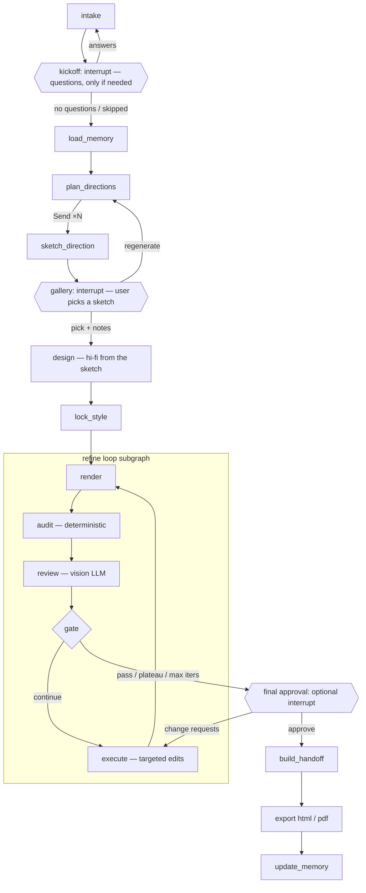

# UI Agent — Project Plan

An agent that works like a UI/UX designer briefed by a PM. The user states **the problem and who has it**, never the look; the agent owns every "how" decision. It may ask a few kickoff questions, sketches several low-fidelity directions, lets the user pick one, designs it in full as a production-ready **web page UI** (HTML/CSS), then refines it through a reviewer ↔ executor loop until it meets a quality bar. The output is a **handoff package** that another coding agent (e.g. Claude Code) uses as the source of truth to build the real project. The design is created **before any codebase exists**.

---

## 1. Goals and non-goals

**Goals**
- Take a PM-style brief: the problem, the target users, and optionally a product name, the goal, and free-form context. Never ask the user to choose colors, fonts, layout, theme or style.
- Ask clarifying questions at kickoff only when the answer would change the design.
- Sketch genuinely different directions (different bets on solving the problem, each with a proposed visual mood) as low-fidelity wireframes, in parallel. The user chooses how many (default 3, range 1–10).
- Let the user pick a sketch (plus optional notes); design only that one in full.
- Automatically refine the chosen design against an explicit UI/UX rubric, with screenshots, until it passes a threshold.
- Output HTML that is easy for a coding agent to integrate: semantic markup, tokenized CSS, labeled components, and a written handoff spec.
- Learn the user's taste and the system's recurring mistakes across runs (long-term memory).

**Non-goals (v1)**
- Multi-page apps or flows. One page per run.
- Framework output (React/Vue/Tailwind). The coding agent translates; we give it clean, framework-agnostic input.
- Matching an existing codebase or design system. This tool makes the *initial* design, before any code exists. (Brand constraints the user mentions in the brief's context are respected by the designer.)
- Real imagery or brand assets. We use annotated placeholders.
- A hosted multi-user SaaS. v1 is a single-user web app (frontend + Python backend) run locally.

---

## 2. Key decisions

| Decision | Choice | Why |
|---|---|---|
| Orchestration | **LangGraph** (Python) | It has the primitives this flow needs: `Send` for the N-way fan-out, `interrupt()` for the human pick, a checkpointer for pause/resume, and `Store` for long-term memory. |
| Control flow | **Deterministic graph; LLMs only inside nodes** | The pipeline is fixed. Code owns routing, stop conditions and retries, so runs are debuggable, resumable and cheaper. |
| LLM access | **Anthropic Python SDK called directly inside nodes** | Gives access to current API features (structured outputs via `messages.parse`, adaptive thinking, effort, refusal fallbacks, prompt caching) without waiting for wrapper support. |
| Model | `claude-sonnet-5-5` for every LLM role (configurable per role in `config.yaml`) | Cost efficiency: half the per-token price of Opus 5.5 ($2 / $10 vs. $4 / $20 per million input/output tokens), which matters with up to 10 generations plus the refine loop per run. Each role is configurable, so a role that falls short on the eval suite (most likely the reviewer or planner) can be moved to `claude-opus-5-5` without touching code. |
| Output format | Single-file HTML + CSS custom properties + `data-component` labels + `HANDOFF.md` + `tokens.json` | The consumer is a coding agent. Structure and a written spec matter more than pixel-perfect files. |
| Styling | **Plain CSS** (no Tailwind or other CSS framework) | Keeps the most design detail: exact values, complex selectors, pseudo-elements, layered gradients, keyframes, `clamp()` type scales, and named tokens. Utility classes compress or hide this, and arbitrary values get messy. The downstream agent can always convert plain CSS to Tailwind later; converting the other way loses information. |
| Starting point | **Greenfield**: no existing codebase | The design comes first and the codebase is built from it, so there's no repo to read or match. |
| Interface | **Web frontend** (Next.js + TypeScript) talking to a Python backend | Sketches, refinement progress and the before/after comparison are visual. An MCP server comes later. |
| Who decides what | **The user states the problem; the agent owns the "how"** | Users think like a PM: problem and users in, no visual pickers. Colors, type, layout, theme and style are design decisions, and they're made for the stated users (§5). |
| Exploration | **Low-fi sketches first, one hi-fi design** | Sketches are cheap and make the *idea* easy to judge; only the picked direction is designed in full (§4.5, §4.7). |
| Review | **Two layers**: deterministic audits (code) + rubric judgment (vision LLM) | Objective checks can't be argued with or hallucinated, and the LLM focuses on what needs judgment. |
| PDF | Optional visual snapshot only | Developers integrate the HTML; a PDF is just for sharing or sign-off. |

---

## 3. Architecture

### 3.1 Graph



### 3.2 State (sketch)

```python
class ProductBrief(BaseModel):     # what the PM says (§5.1)
    problem: str
    audience: str
    product_name: str | None
    goal: str | None
    context: str | None

class DirectionBrief(BaseModel):   # one direction = UX concept + visual mood
    id: str
    name: str                    # e.g. "Snap and Forget"
    concept: str                 # how this direction solves the problem for these users
    tradeoff: str                # what it gives up
    sections: list[str]          # page sections, in order
    layout_archetype: str
    reference_style: str
    mood: list[str]              # e.g. ["calm", "trustworthy"]
    theme: Literal["light", "dark"]
    heading_font: str; body_font: str
    palette: dict[str, str]      # role -> hex, contrast-checked in code
    density / shape / motion / imagery
    signature_element: str
    avoid: list[str]

class AgentState(TypedDict):
    run_id: str
    user_id: str
    brief: ProductBrief
    candidate_count: int                                 # 1–10, default 3
    intake: DesignBrief                                  # the designer's reading of the brief (+ questions)
    kickoff: Kickoff | None                              # answers, or skipped
    memory_context: dict
    briefs: list[DirectionBrief]
    candidates: Annotated[list[Design], reducer]         # sketches (fan-out reducer)
    selection: Selection | None                          # chosen id + notes
    design: Design | None                                # first full design (refine v1)
    style_lock: StyleSpec | None
    current: Design | None
    best: Design | None
    history: list[Design]
    iteration: int
    resolved_issue_ids: list[str]
    stop_reason: str | None
    usage: TokenUsage                                    # running cost tracking
```

Checkpointer: SQLite locally (Postgres later). Each run is one `thread_id`, so a run can stop at any interrupt and resume hours later.

### 3.3 System components

```
Next.js frontend  ⇄  FastAPI backend  →  LangGraph run (background task)  →  Playwright / Anthropic API
                      │                                                    
                      └─ serves run artifacts (HTML, screenshots, zip, PDF)
```

**Backend API** (FastAPI wrapping the compiled graph):

| Endpoint | Purpose |
|---|---|
| `POST /runs` | Start a run with a `ProductBrief` + `candidate_count` → `run_id` |
| `GET /runs/{id}/events` | Server-sent events (SSE) stream: node started/finished, the design brief, each sketch ready, the full design, each refine iteration (screenshot, score, issues), interrupts |
| `POST /runs/{id}/resume` | Answer an interrupt (kickoff answers / sketch pick / regenerate / final approval) → `Command(resume=...)` |
| `GET /runs/{id}/artifacts/...` | Sketch and design HTML (shown in sandboxed iframes), screenshots, handoff zip, PDF |
| `GET/PUT/DELETE /memory` | View, edit and reset what the agent remembers |

The graph streams progress through LangGraph's custom stream mode, which the API relays as SSE. (Alternative: LangGraph Server plus its React `useStream` hook. That's less code, but less control over the API shape.)

**Frontend screens:**
1. **Brief:** problem, users, optional name, goal and context, and the number of directions to sketch (§5).
2. **Kickoff:** the designer's reading of the brief (problem, users, needs, primary action, assumptions) plus its questions, each with one-click suggested answers and a line on why it matters. Answer or skip. Shown only when the designer has questions.
3. **Sketching:** one card per direction (concept, trade-off, mood swatch), filling in as each sketch finishes.
4. **Pick a sketch:** sketches in a grid; each opens to a desktop iframe + mobile view, and any two can be compared side by side. Pick + notes, or ask for new directions with feedback.
5. **Designing & refining:** the chosen sketch becomes a full design, then a timeline of iterations, each showing screenshot, score per criterion, and issues found and fixed. Every issue gets a **plain-English explanation of why it matters**, so the user learns UI/UX while the design improves.
6. **Final review:** the picked sketch (or the first full design) vs. final side by side, score trajectory, and approve or request changes.
7. **Download:** handoff package (zip), HTML, PDF.
8. **Memory:** remembered taste, lessons and runs, with reset.

Generated HTML always renders in a sandboxed `<iframe>` (no same-origin), never inline in the app.

---

## 4. Nodes

### 4.1 `intake`
Reads the PM's brief like a designer at kickoff and writes a design brief: the problem restated as a design problem, who the users are (context, skepticism, likely device), what they must understand/feel/do, the primary action, the page type and sections, and assumptions for every gap it filled. It may also return up to 3 **questions**, only when an answer would clearly change the design. It never asks about colors, fonts, layout or style. On its second pass (after answers) it updates the brief and returns no questions.

### 4.2 `kickoff` (interrupt #1, only when there are questions)
`interrupt()` with the design brief and the questions; each has suggested answers and a one-line "why it matters". Answers send the graph back to `intake` to update the brief; skipping keeps the assumptions. Either way the next stop is `load_memory`.

### 4.3 `load_memory`
Reads the user's taste profile, project brand kit (if any), and the system's lessons learned from the Store (see §9).

### 4.4 `plan_directions`
One LLM call with structured output that returns `candidate_count` `DirectionBrief`s. A direction is **a different bet on solving the problem** (what it leads with, how it earns trust, how it gets users to the primary action), plus the visual mood the designer proposes for it: style, mood words, theme, type pairing, palette, density, shape, motion, imagery and a signature element. The presets (§5.4) are the designer's library: vocabulary and starting points, never constraints.

Diversity is enforced in three places:
- **Prompt:** every pair differs in concept and on at least 3 of: layout archetype, type pairing, palette, density, reference style, section order, theme.
- **Composition (scales with the count):**
  - 1 option: a single best-fit direction, informed by remembered taste.
  - 2 options: 1 leans toward remembered taste, 1 is neutral-strong.
  - 3+ options: about 40% lean toward remembered taste (at least 1), exactly 1 is a deliberate wildcard, and the rest are neutral-strong.
  - With no taste memory yet, taste slots become neutral-strong.
- **Check (code):** reject and re-plan if two briefs share the same layout archetype and reference style, differ on fewer than 3 axes, or share a concept or signature element.

**Palette check (code):** every text/background and button pair in each palette is checked for WCAG AA contrast. Failing pairs are repaired by shifting OKLCH lightness within the same hue, before any sketching starts.

### 4.5 `sketch_direction` (×N via `Send`)
Each sketcher gets the PM brief, the design brief, kickoff answers and one direction, and writes a **low-fidelity wireframe** as HTML: structure, hierarchy, real copy for everything that carries the concept, text-line placeholders for running copy, and 2–4 annotations explaining *why* a part is shaped that way. It builds with a shared **sketch kit** (`prompts/sketch_kit.css`: grayscale ink on paper, annotations in blue) that code injects at the top of `<head>`; the sketcher adds layout CSS only. Sketches are rendered at every viewport for screenshots (no audit: a sketch is judged by the person, not the rubric). At most `max_parallel_generations` (default 5) run at once.

### 4.6 `gallery` (interrupt #2)
`interrupt()` with the design brief and the sketches: each opens to a sandboxed iframe at 1440px plus a mobile view, and any two can be compared side by side. Each card shows the direction's concept, trade-off and **mood** (palette swatches, font names set in those fonts, theme, mood words), so picking a sketch also picks a look. With a single sketch the gallery still appears.
The user chooses one of:
- `pick(id, notes?)`, e.g. "put the pricing teaser higher; B's testimonials idea would fit here"
- `regenerate(feedback, count?)`: back to `plan_directions`, which moves away from the previous directions.

### 4.7 `design`
One generator turns the picked sketch into the **first full design** (`refine/v1.html`): it keeps the sketch's section order, structure, hierarchy and content, makes every visual decision within the direction's mood, applies the PM's notes, and follows the **HTML contract** (§7) and the lessons-learned checklist. It sees the sketch's HTML and its first desktop screen.

### 4.8 `lock_style`
Builds a `StyleSpec` from the first full design:
- **Deterministic:** parse `:root` custom properties (colors, fonts, spacing scale, radii, shadows).
- **LLM:** a short description of the design's character and signature elements, plus the PM's notes.

The StyleSpec is the "don't lose what the user picked" constraint for the rest of the run. The PM's notes become a high-severity issue that the reviewer verifies like any other.

### 4.9 Refine loop (subgraph)

**`render`**: Playwright at 375 / 768 / 1440 px. Screenshots are taken per viewport **in viewport-height tiles**, because tall full-page images get downscaled and lose detail. Also captures a simplified DOM plus key computed styles: font sizes, colors, spacing, and bounding boxes of `data-component` sections.

**`audit`**: Layer A checks (§6.1). Pure code, no LLM.

**`review`**: A fresh-context vision LLM with structured output.
- **Inputs:** screenshots, DOM summary, audit results, StyleSpec, the PM brief and design brief, and the list of previously raised issues. It marks each as resolved or not, then does a fresh pass.
- **Never sees:** the executor's reasoning or edit history narrative.
- **Output:** per-criterion scores with evidence, plus a list of `Issue`s (§6.3).

**`gate`**: Pure code (§8). Picks `continue`, `pass`, `plateau`, `max_iters` or `revert`.

**`execute`**: The LLM gets the current HTML, the **top 5 open issues by severity** (not all of them), the StyleSpec, and a "do not regress" list of resolved issues. It edits with the Anthropic text-editor tool (`str_replace` on the file), so changes are targeted rather than a full regeneration. Each round writes a new version, `vN.html`.

### 4.10 `final_approval` (interrupt #3, optional, on by default)
Shows the picked sketch (or the first full design) vs. final, the score trajectory, and remaining low-severity issues. Two outcomes:
- **Approve:** continue to handoff.
- **Request changes:** the feedback becomes high-severity issues, and the loop runs again with a small iteration cap.

### 4.11 `build_handoff`
An LLM writes `HANDOFF.md` from the final HTML plus the StyleSpec (§7.2). `tokens.json` is extracted deterministically.

### 4.12 `export`
- HTML: final file, validated as self-contained.
- PDF (optional): Playwright `page.pdf()` at a fixed 1440px width with print CSS that prevents section breaks, plus a separate mobile-width PDF if requested.

### 4.13 `update_memory`
Writes the taste signal, lessons learned and a run summary (§9).

---

## 5. The brief (what the user says) and the library (what the designer uses)

The user thinks like a PM talking to a UI/UX designer: **what problem, for whom**. Everything about *how* (colors, fonts, layout, theme, style, density) is the designer's job, decided for the stated users.

### 5.1 The brief screen
| Field | Required | Example |
|---|---|---|
| What problem are we solving? | yes | "Freelancers lose receipts and dread tax season." |
| Who are we solving it for? | yes | "Solo freelancers who do their own books, mostly on their phone. Skeptical of finance apps." |
| Product name | no | "Receiptly" |
| What should they do or come away with? | no | "Sign up for the free plan" |
| Anything else the designer should know? | no | Constraints, an existing brand, competitors, what's been tried, real copy |

Plus the number of directions to sketch (stepper, default **3**, 1–10). A side panel explains the flow: kickoff → sketches → pick one → hand off.

There are deliberately **no visual pickers**. If the user has a hard constraint (e.g. an existing brand color), they say so in the context field and the designer respects it.

### 5.2 Kickoff questions
The designer asks at most 3 questions, only when the answer would clearly change the design (who it's for, what it must achieve, a hard constraint). Each comes with suggested answers and a line on why it matters. Skipping is always allowed; the designer then records assumptions. Clear briefs get no questions and go straight to sketching.

### 5.3 Schema (sketch)

```python
class ProductBrief(BaseModel):
    problem: str                     # required
    audience: str                    # required
    product_name: str | None = None
    goal: str | None = None
    context: str | None = None

class RunRequest(BaseModel):         # body of POST /runs
    brief: ProductBrief
    candidate_count: int = Field(3, ge=1, le=10)
```

### 5.4 The designer's library (`presets/*.json`)
Curated reference material the planner draws on: reference styles (with guidance), layouts per page type, color directions (OKLCH ranges + AA-validated example palettes), type pairings, and density/shape/motion/imagery tokens. They are vocabulary and starting points, not constraints. CI validates them: every example palette meets WCAG AA in both themes and stays within its direction's ranges; fonts load from the allowlist; every page type has layouts and defined sections; every entry is described.

### 5.5 Priority rule
**Accessibility > the PM's notes and the picked direction > the reviewer's taste.**
- The reviewer and executor never override the picked direction for aesthetic reasons. B9 penalizes drifting from the sketch, the StyleSpec or the PM's notes.
- If a proposed palette fails contrast, code adjusts it *within* the same hue before sketching, and the change is shown.

### 5.6 Never exposed
Spacing scale, type-scale ratio, grid columns, exact font sizes, line heights, contrast and visual hierarchy, and now every other visual choice too. This is what the designer and the reviewer own.

---

## 6. Rubric

Stored in `rubric/rubric.yaml` (versioned, so score changes can be traced back to rubric changes).

### 6.1 Layer A: deterministic gates (all must pass)

| ID | Check | Tool | Pass |
|---|---|---|---|
| A1 | Accessibility violations | axe-core in Playwright | 0 serious/critical |
| A2 | Text contrast | axe + computed styles | ≥ 4.5:1 body, ≥ 3:1 large text |
| A3 | Horizontal overflow | `scrollWidth > clientWidth` at each viewport | none |
| A4 | Tap target size (mobile) | bounding boxes of interactive elements | ≥ 44×44 px (min 24×24) |
| A5 | Font size floor | computed styles | body ≥ 16px on mobile, nothing < 12px |
| A6 | HTML validity, console errors | html-validate, Playwright console | 0 errors |
| A7 | Focus visibility | tab through, compare focus vs. unfocused styles | every interactive element has a visible focus state |
| A8 | Integrability | custom script | no inline `style=`; ≥ 90% of color/font/spacing values use `var(--*)`; every top-level section has `data-component`; no network requests outside the allowlist |

### 6.2 Layer B: LLM-judged (1–5 each, anchored descriptions per score in the YAML)

| ID | Criterion | Weight |
|---|---|---|
| B1 | Visual hierarchy and scannability: one clear focal point per section, obvious primary CTA | 1.5 |
| B2 | Layout, spacing rhythm and alignment: consistent scale, grid adherence | 1.25 |
| B3 | Typography: scale, line length, leading, pairing | 1.0 |
| B4 | Color: purposeful, consistent roles, not muddy | 1.0 |
| B5 | Responsive quality: mobile layout *makes sense*, not just "doesn't overflow" | 1.25 |
| B6 | Component consistency: buttons, cards, inputs share one visual language | 1.0 |
| B7 | Brief fit and content: built for these users and this problem, the primary action is the page's center of gravity, realistic copy, no lorem ipsum | 1.25 |
| B8 | Interaction states: hover/focus/active/disabled defined for interactive elements | 0.75 |
| B9 | **Fidelity to the chosen direction**: still recognizably the sketch and direction the user picked, StyleSpec signature elements intact, every PM note applied | 1.5 |

**Pass condition:** all Layer A pass **AND** weighted B average ≥ **4.0** **AND** no criterion < **3** **AND** no open `high` issues.

### 6.3 Issue schema (reviewer output)

```json
{
  "id": "iss_hero_cta_contrast",
  "criterion": "B1",
  "severity": "high | medium | low",
  "selector": "[data-component=hero] .btn--primary",
  "viewport": "mobile",
  "evidence": "CTA is below the fold at 375px; headline wraps to 5 lines",
  "suggested_fix": "Reduce hero h1 clamp max to 2.5rem on mobile; move CTA above image",
  "explanation": "On phones, visitors decide in the first screen. If the main button isn't visible without scrolling, many never see it.",
  "status": "open | resolved | regressed"
}
```

`explanation` is written for developers without design training. The Refining screen shows it next to each issue so users learn the principle, not just the fix.

Issue IDs stay stable across rounds (the reviewer is given previous IDs), so resolution and regressions can be tracked.

---

## 7. Output contract (for the downstream coding agent)

### 7.1 HTML contract (given to generators and the executor)
- One `index.html` file. CSS in a single `<style>` block. No JS unless the design needs it (e.g. mobile nav toggle); if so, small vanilla JS in one `<script>`.
- **Plain, hand-written CSS only.** No Tailwind, Bootstrap, CDN resets or utility-class systems. Use modern CSS freely (grid, `clamp()`, custom properties, `:has()`, `@keyframes`, `prefers-reduced-motion`). Prefer explicit, exact values expressed as tokens over approximations, because the point is to keep every design decision visible to the downstream agent.
- **All design tokens are CSS custom properties on `:root`**: colors (semantic roles: `--color-bg`, `--color-surface`, `--color-text`, `--color-primary`…), font families, type scale, spacing scale, radii, shadows, breakpoints documented in comments.
- Semantic landmarks: `header`, `nav`, `main`, `section`, `footer`. One `h1`. Logical heading order.
- Every major block has `data-component="<name>"` (e.g. `hero`, `feature-grid`, `pricing-table`) and BEM-style class names.
- Mobile-first media queries at 768 / 1024 / 1280.
- Icons as inline SVG. Images as CSS or SVG placeholders annotated with `data-placeholder="hero-image 1200x800, product screenshot"`.
- Fonts: system stacks or Google Fonts only (allowlisted), declared once.
- Interaction states defined for every interactive element.
- Realistic copy derived from the prompt.

### 7.2 Handoff package

```
output/<run_id>/
├── index.html            # final design
├── tokens.json           # design tokens (W3C Design Tokens format)
├── HANDOFF.md            # integration spec for the coding agent
├── screenshots/          # mobile.png, tablet.png, desktop.png
├── review-report.json    # final scores, remaining low-severity issues, iterations
├── design.pdf            # optional
└── history/              # v1.html … vN.html + per-iteration review JSON
```

`HANDOFF.md` contains:
- a component inventory (each `data-component`: purpose, structure, variants, states, responsive behavior)
- a token table
- placeholder/asset list
- accessibility notes
- known limitations
- a short "how to build from this" section, e.g. "set up tokens as the theme first, build components top-down, then compare against the screenshots"

---

## 8. Loop control (`gate`)

Evaluated in order after each review:

1. **Pass**: the pass condition in §6.2 → exit.
2. **Regression guard**: if `score < best.score − 0.2` or any previously resolved `high` issue reopened → revert `current` to `best` and continue, telling the executor what it broke.
3. **Plateau**: best score improved by < 0.1 over the last 2 iterations → exit with the best version.
4. **Max iterations**: 5 (configurable) → exit with the best version.
5. Otherwise → `execute`.

The output is always **`best`**, never just the latest version. `stop_reason` is recorded and shown to the user.

---

## 9. Long-term memory (LangGraph `Store`)

| Namespace | Contents | Written when | Read by |
|---|---|---|---|
| `("user", uid, "taste")` | Structured profile: preferred/avoided styles, layouts, fonts, density, shape; counts of picks vs. rejects per attribute | After each sketch pick (chosen vs. passed-over directions), and from user notes | `plan_directions` (the `taste` slots) |
| `("project", pid, "brand")` | Brand constraints the user provides explicitly (colors, fonts, logo rules) so they carry across runs for the same product | Explicit user action | planner, generators, StyleSpec |
| `("system", "lessons")` | Recurring issue patterns (e.g. "missing focus states", "hero CTA below fold on mobile") with counts | After each run, from final review issues | generators + executor (as a pre-flight checklist) |
| `("runs", uid)` | Run summaries: prompt, chosen direction, iterations, final score, stop reason | End of run | analytics, evals |

**Write policy:** memory is updated only from explicit signals (picks, notes, approvals, recurring issues). Raw transcripts are not stored. A lesson is promoted only after it shows up in ≥ 3 runs. Users view, edit and reset memory on the Settings screen.

---

## 10. LLM usage

- Model: `claude-sonnet-5-5` for all roles by default, chosen for cost. The role → model mapping lives in `config.yaml`; `claude-opus-5-5` is the upgrade path for any role the evals show needs it.
- One `llm.py` wrapper owns all calls:
  - **Structured outputs** (`client.messages.parse` with Pydantic models) for briefs, reviews and StyleSpec. Forced `tool_choice` isn't supported on this model, so use structured outputs or `tool_choice: auto` with strict tools.
  - **Adaptive thinking** with **explicit `effort`** per role (default for this model is `high`, and its levels are recalibrated from earlier Sonnets, so always set it explicitly):
    - `high` for planner, reviewer and executor
    - `medium` for generators to start
    - tune both with the eval suite (§13); cost per completed run, not per request, is the measure
  - **Streaming** for HTML generation and edits (long outputs), using `get_final_message()`.
  - **Prompt caching** on the stable prefix: system prompt + HTML contract + rubric. Volatile content (screenshots, current HTML) goes after the cache breakpoint. Check `usage.cache_read_input_tokens` to confirm hits.
  - **Refusal handling:** check `stop_reason` before reading content; enable server-side refusal fallbacks (`fallbacks: "default"`, the only form this model accepts, on the Claude API).
  - **Usage logging:** tokens per node per run go into `state.usage`, with a per-run budget cap.
- Executor edits use the Anthropic-defined text editor tool, applied by our handler to the run directory only.
- Images are sent as base64 PNG content blocks. Each review call has ~6–12 tiles; keep tile size reasonable.

---

## 11. Tech stack and layout

- Python 3.12, `uv`
- `langgraph`, `langgraph-checkpoint-sqlite`, `anthropic`, `pydantic`
- `playwright` (Chromium), axe-core (injected `axe.min.js`), `html-validate` via Node for HTML validity
- `fastapi` + `uvicorn` backend API with SSE streaming
- Frontend: Next.js + TypeScript. Sample fonts load from Google Fonts. The palette generator for brand colors runs client-side (OKLCH). The app's own UI styling is independent of the designs it generates.
- Tracing: LangSmith or Langfuse

```
ui-agent/
├── presets/                    # single source of truth for options (§5.4), used by frontend + backend
│   ├── styles.json  layouts.json  colors.json  typography.json  shapes.json  ...
│   └── thumbnails/             # hand-made style/mood sample images
├── frontend/                   # Next.js app: setup, generating, gallery, refining, final, download, settings
├── pyproject.toml              # Python backend (src/ui_agent)
├── config.yaml                 # models, effort, thresholds, viewports, max iters
├── rubric/rubric.yaml
├── prompts/                    # versioned prompt templates (planner, generator, reviewer, executor, handoff)
├── scripts/                    # internal dev tools: audit.py, refine.py (not user-facing)
├── src/ui_agent/
│   ├── api/                    # FastAPI app: runs, events (SSE), resume, artifacts, presets, memory
│   ├── graph.py                # top-level StateGraph wiring
│   ├── refine_graph.py         # refine-loop subgraph
│   ├── state.py                # TypedDict + Pydantic schemas
│   ├── llm.py                  # Anthropic client wrapper
│   ├── nodes/
│   │   ├── intake.py  planner.py  generator.py  gallery.py  style_lock.py
│   │   ├── render.py  audit.py  reviewer.py  gate.py  executor.py
│   │   └── handoff.py  export.py  memory_nodes.py
│   ├── tools/
│   │   ├── browser.py          # Playwright session, tiling, DOM summary
│   │   ├── checks/             # one module per Layer-A check
│   │   └── text_editor.py      # sandboxed str_replace handler
│   └── memory/store.py
├── evals/
│   ├── prompts.jsonl           # benchmark prompts
│   ├── human_scores/           # calibration labels
│   └── run_eval.py
└── tests/
```

---

## 12. Milestones

**M0: Tooling without LLMs (≈ 3–4 days)**
- `browser.py` (render, tiles, DOM summary) and all Layer-A checks.
- `scripts/audit.py page.html` (internal dev tool) prints a report.
- Unit tests using fixture HTML files with known defects.
- *Exit:* each check catches its seeded defect and passes the clean fixture.

**M1: Refine loop on a given HTML (≈ 1 week)** *(the core; build and tune first)*
- `llm.py`, reviewer, executor, gate, refine subgraph, history/versioning.
- `scripts/refine.py page.html --problem "..." --audience "..."` (internal dev tool).
- *Exit:* on 10 sample pages, mean weighted score rises, every run ends within ≤ 5 iterations, and there are no unhandled regressions.

**M2: Designer's library (≈ 3 days, can run in parallel with M1)**
- Define `presets/*.json` (styles, layouts per page type, ~10 color directions with ranges and example palettes, typography pairings, density, shape, motion, imagery) and add CI validation (contrast, ranges, fonts, coverage).
- *Exit:* every entry passes validation.

**M3: Generation backend + API (≈ 1 week)**
- `ProductBrief`, `RunRequest`, intake + kickoff interrupt, planner (concept-level diversity, 1–10 directions, contrast repair), `Send` fan-out of sketchers with the sketch kit and a parallelism cap, gallery interrupt, regenerate path, design-from-sketch, `lock_style`.
- FastAPI: `/runs`, `/runs/{id}/events` (SSE), `/runs/{id}/resume`, artifacts.
- *Exit:* a full run driven only through the API, from a PM brief to a refined design; users judge the sketches as clearly different bets on the problem, and the full design as faithful to the picked sketch.

**M4: Frontend (≈ 2 weeks)**
- Brief screen, Kickoff (questions with suggested answers), Sketching, Pick a sketch (concept, trade-off, mood), Designing & refining (timeline + plain-English explanations), Final review (sketch or v1 vs. final), Download screens.
- *Exit:* someone with no design background completes a run without help (hallway test with 3–5 people), and can explain how the sketches differ as approaches to the problem.

**M5: Handoff and export (≈ 3 days)**
- `HANDOFF.md`, `tokens.json`, PDF, final-approval interrupt, zip download.
- *Exit:* Claude Code, given only the package, scaffolds a new project (e.g. Next.js) that reproduces the design. Check fidelity with a screenshot diff against `screenshots/` at all three viewports.

**M6: Memory (≈ 4 days)**
- Store namespaces, write policy, taste from sketch picks, injection into planner/designer, Memory screen.
- *Exit:* after 5 runs with consistent picks, the "taste" directions in later runs reflect those preferences.

**M7: Hardening (ongoing)**
- Eval suite, cost dashboards, Postgres checkpointer/store.
- **MCP server interface**, so a coding agent can call `generate_ui(brief)` and receive the handoff package directly. The gallery pick still happens in the browser.

---

## 13. Evaluating the system itself

- **Benchmark set:** about 20 prompts covering landing, pricing, SaaS dashboard overview, blog/article, signup/auth, portfolio, docs home, e-commerce product page.
- **Metrics per run:**
  - Layer-A pass rate (v1 vs. final)
  - weighted B score (v1 vs. final)
  - iterations to stop and stop-reason distribution
  - regressions caught
  - tokens/cost and wall time
- **Reviewer calibration:** a human scores about 20 designs on the rubric. Compare against reviewer scores (rank correlation) and adjust anchors and weights until they agree reasonably. Re-check whenever prompts or the rubric change.
- **Blind preference test:** humans compare v1 vs. final for the same direction. Refinement should win clearly; if it doesn't, the loop is making pages blander and B9 needs more weight.
- **Diversity:** the user rates the "distinctness" of the generated directions (tested at 3, 5 and 10 options), plus a cheap automated proxy (pairwise screenshot embedding distance).
- **Build-from-handoff test (M3+):** a scripted Claude Code session builds a fresh project from the package. Measure visual fidelity (screenshot diff), token usage in the generated code, and the amount of manual fixing needed.

---

## 14. Risks and mitigations

| Risk | Mitigation |
|---|---|
| Directions look alike (worse at high counts) | Concept-level directions, axis-differentiated briefs, wildcard slot, automated similarity check |
| AI-composed colors clash or fail contrast | Color directions bound the hue/chroma range, code checks every palette before generation, B4 judges color quality |
| Reviewer too lenient or never satisfied | Anchored rubric, deterministic gates, calibration against human scores, plateau stop |
| Oscillation (fix A breaks B) | Top-5 issues per round, "do not regress" list, regression guard and revert-to-best |
| Refinement erases character | StyleSpec lock and B9 fidelity criterion with high weight |
| Vision misses fine detail | Tiled screenshots plus DOM/computed-style measurements |
| Full rewrites undo earlier fixes | Executor limited to text-editor `str_replace` edits |
| Cost creep (up to 10 generations + loop + images) | Default of 3 options, cost hint next to the stepper, parallelism cap, per-node usage logging, per-run budget cap, prompt caching, effort tuning via evals |
| Memory pollution | Only explicit signals, promotion threshold, user-editable memory |

---

## 15. Decisions log and open questions

**Decided**
- **Sonnet 5.5, not Opus 5.5:** half the per-token cost; any role can move to Opus 5.5 in `config.yaml` if evals show it needs to (§2, §10).
- **Plain CSS, not Tailwind:** keeps the most detail for the downstream agent (see §2).
- **Greenfield only:** no matching an existing codebase or design system. The design comes first.
- **Web frontend, not CLI:** developers need to *see* each option (§3.3, §5). MCP server later (M7).
- **The user states the problem, the agent owns the how:** the setup screen's style, layout, color, theme, typography, density, shape, motion and imagery pickers were removed. The user gives a PM-style brief (problem, users, optional name, goal, context); presets became the designer's internal library (§5).
- **Kickoff questions:** the designer may ask up to 3 clarifying questions before sketching, only when the answer changes the design; skipping is allowed (§4.2, §5.2).
- **Sketch first:** N low-fi wireframes plus a visual mood per direction; only the picked one is designed in full (§4.5–4.7).
- **Number of directions:** chosen by the user, 1–10, default 3.
- **Theme is a design decision:** each direction picks light or dark for its users.

**Open**
1. **Dark mode:** each direction picks one theme today. Should the full design also ship the other theme via tokens?
2. **Mixing directions** ("A's layout + C's palette") as a first-class gallery action instead of free-text notes?
