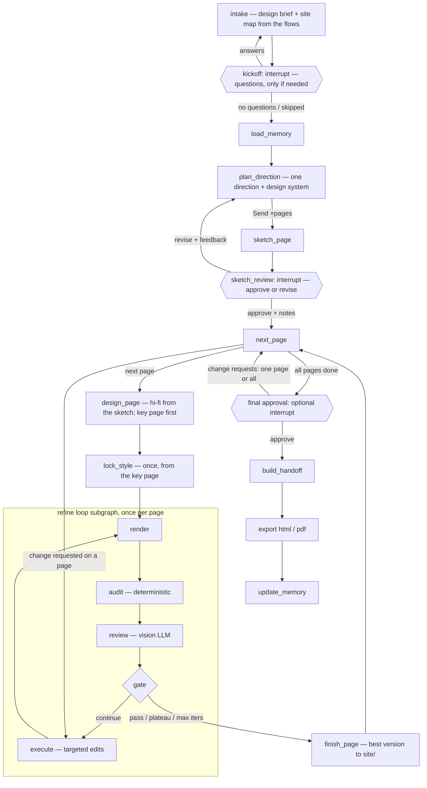

# UI Agent — Project Plan

An agent that works like a UI/UX designer briefed by a PM. The user states **the problem and what users do** (at least one user flow), never the pages or the look; the agent owns every "how" decision. It works out the pages the flows need, may ask a few kickoff questions, proposes one direction with a low-fidelity sketch of every page, lets the user approve it or ask for changes, designs every page in full as a production-ready, linked **multi-page web UI** (HTML/CSS) in one design system, then refines it through a reviewer ↔ executor loop until it meets a quality bar. The output is a **handoff package** that another coding agent (e.g. Claude Code) uses as the source of truth to build the real project. The design is created **before any codebase exists**.

---

## 1. Goals and non-goals

**Goals**
- Take a PM-style brief: the problem, one to five user flows (one free-text paragraph each; the first is required), and optionally the users, a product name and free-form context. Never ask the user to choose pages, colors, fonts, layout, theme or style.
- Ask clarifying questions at kickoff only when the answer would change the design.
- Turn the flows into a site map (at most 6 pages) and propose one direction for the whole site: a bet on solving the problem plus a design system. Sketch every page as a low-fidelity wireframe, in parallel.
- Let the user approve the direction and sketches (plus optional notes) or ask for changes; design nothing in full until then.
- Design the entry page of flow 1 first; it sets the design system. Design every other page against it with the same tokens, header, footer and components, and link the pages so every flow can be clicked through.
- Automatically refine each page against an explicit UI/UX rubric, with screenshots, until it passes a threshold.
- Output HTML that is easy for a coding agent to integrate: semantic markup, tokenized CSS, labeled components, and a written handoff spec.
- Learn the user's taste and the system's recurring mistakes across runs (long-term memory).

**Non-goals (v1)**
- More than 6 pages per run, or app logic behind the flows. Pages are static and link to each other; forms and buttons only navigate.
- Framework output (React/Vue/Tailwind). The coding agent translates; we give it clean, framework-agnostic input.
- Matching an existing codebase or design system. This tool makes the *initial* design, before any code exists. (Brand constraints the user mentions in the brief's context are respected by the designer.)
- Real imagery or brand assets. We use annotated placeholders.
- A hosted multi-user SaaS. v1 is a single-user web app (frontend + Python backend) run locally.

---

## 2. Key decisions

| Decision | Choice | Why |
|---|---|---|
| Orchestration | **LangGraph** (Python) | It has the primitives this flow needs: `Send` for the N-way fan-out, `interrupt()` for the human pick, a checkpointer for pause/resume, and `Store` for long-term memory. |
| Control flow | **Deterministic graph; LLMs only inside nodes** | The pipeline is fixed. Code owns routing, stop conditions and retries, so runs are debuggable, resumable and cheaper. |
| LLM access | **Anthropic Python SDK called directly inside nodes** | Gives access to current API features (structured outputs via `messages.parse`, adaptive thinking, effort, refusal fallbacks, prompt caching) without waiting for wrapper support. |
| Model | `claude-sonnet-5-5` for every LLM role (configurable per role in `config.yaml`) | Cost efficiency: half the per-token price of Opus 5.5 ($2 / $10 vs. $4 / $20 per million input/output tokens), which matters with up to 10 generations plus the refine loop per run. Each role is configurable, so a role that falls short on the eval suite (most likely the reviewer or planner) can be moved to `claude-opus-5-5` without touching code. |
| Output format | Single-file HTML + CSS custom properties + `data-component` labels + `HANDOFF.md` + `tokens.json` | The consumer is a coding agent. Structure and a written spec matter more than pixel-perfect files. |
| Styling | **Plain CSS** (no Tailwind or other CSS framework) | Keeps the most design detail: exact values, complex selectors, pseudo-elements, layered gradients, keyframes, `clamp()` type scales, and named tokens. Utility classes compress or hide this, and arbitrary values get messy. The downstream agent can always convert plain CSS to Tailwind later; converting the other way loses information. |
| Starting point | **Greenfield**: no existing codebase | The design comes first and the codebase is built from it, so there's no repo to read or match. |
| Interface | **Web frontend** (Next.js + TypeScript) talking to a Python backend | Sketches, refinement progress and the before/after comparison are visual. An MCP server comes later. |
| Who decides what | **The user states the problem; the agent owns the "how"** | Users think like a PM: problem and users in, no visual pickers. Colors, type, layout, theme and style are design decisions, and they're made for the stated users (§5). |
| Exploration | **One direction, a low-fi sketch per page, then hi-fi pages** | Sketches are cheap and make the structure of every page easy to judge before anything is designed in full (§4.5–4.7). One direction keeps the PM's decision to "is this right?" across the whole site instead of a pick among single pages. |
| Review | **Two layers**: deterministic audits (code) + rubric judgment (vision LLM) | Objective checks can't be argued with or hallucinated, and the LLM focuses on what needs judgment. |
| PDF | Optional visual snapshot only | Developers integrate the HTML; a PDF is just for sharing or sign-off. |

---

## 3. Architecture

### 3.1 Graph



### 3.2 State (sketch)

```python
class ProductBrief(BaseModel):     # what the PM says (§5.1)
    problem: str
    audience: str
    product_name: str | None
    goal: str | None
    context: str | None

class DirectionBrief(BaseModel):   # one direction = UX concept + visual mood
    id: str
    name: str                    # e.g. "Snap and Forget"
    concept: str                 # how this direction solves the problem for these users
    tradeoff: str                # what it gives up
    sections: list[str]          # page sections, in order
    layout_archetype: str
    reference_style: str
    mood: list[str]              # e.g. ["calm", "trustworthy"]
    theme: Literal["light", "dark"]
    heading_font: str; body_font: str
    palette: dict[str, str]      # role -> hex, contrast-checked in code
    density / shape / motion / imagery
    signature_element: str
    avoid: list[str]

class AgentState(TypedDict):
    run_id: str
    user_id: str
    brief: ProductBrief
    intake: DesignBrief                                  # the designer's reading of the brief + site map (+ questions)
    kickoff: Kickoff | None                              # answers, or skipped
    memory_context: dict
    direction: DirectionBrief                            # one direction for the whole site
    sketches: Annotated[list[Sketch], reducer]           # one per page (fan-out reducer)
    sketch_notes: str                                    # the PM's notes at sketch review
    style_lock: StyleSpec | None                         # from the key page; its tokens bind every page
    page_queue: list[str]                                # pages still to design or revisit
    pages: dict[str, PageResult]                         # finished pages: v1, best, issues, stop reason
    page_id: str | None                                  # the page in the refine loop now
    design: Design | None                                # this page's first full design (refine v1)
    current: Design | None
    best: Design | None
    history: list[Design]
    iteration: int
    resolved_issue_ids: list[str]
    stop_reason: str | None
    usage: TokenUsage                                    # running cost tracking
```

Checkpointer: SQLite locally (Postgres later). Each run is one `thread_id`, so a run can stop at any interrupt and resume hours later.

### 3.3 System components

```
Next.js frontend  ⇄  FastAPI backend  →  LangGraph run (background task)  →  Playwright / Anthropic API
                      │                                                    
                      └─ serves run artifacts (HTML, screenshots, zip, PDF)
```

**Backend API** (FastAPI wrapping the compiled graph):

| Endpoint | Purpose |
|---|---|
| `POST /runs` | Start a run with a `ProductBrief` (problem + flows) → `run_id` |
| `GET /runs/{id}/events` | Server-sent events (SSE) stream: node started/finished, the design brief, each sketch ready, the full design, each refine iteration (screenshot, score, issues), interrupts |
| `POST /runs/{id}/resume` | Answer an interrupt (kickoff answers / sketch pick / regenerate / final approval) → `Command(resume=...)` |
| `GET /runs/{id}/artifacts/...` | Sketch text, design HTML (shown in sandboxed iframes), screenshots, handoff zip, PDF |
| `GET/PUT/DELETE /memory` | View, edit and reset what the agent remembers |

The graph streams progress through LangGraph's custom stream mode, which the API relays as SSE. (Alternative: LangGraph Server plus its React `useStream` hook. That's less code, but less control over the API shape.)

**Frontend screens:**
1. **Brief:** problem, users, optional name, goal and context, and the number of directions to sketch (§5).
2. **Kickoff:** the designer's reading of the brief (problem, users, needs, primary action, assumptions) plus its questions, each with one-click suggested answers and a line on why it matters. Answer or skip. Shown only when the designer has questions.
3. **Sketching:** one card per direction (concept, trade-off, mood swatch), filling in as each sketch finishes.
4. **Pick a sketch:** sketches in a grid; each opens to its full text wireframe, and any two can be compared side by side. Pick + notes, or ask for new directions with feedback.
5. **Designing & refining:** the chosen sketch becomes a full design, then a timeline of iterations, each showing screenshot, score per criterion, and issues found and fixed. Every issue gets a **plain-English explanation of why it matters**, so the user learns UI/UX while the design improves.
6. **Final review:** the picked sketch (or the first full design) vs. final side by side, score trajectory, and approve or request changes.
7. **Download:** handoff package (zip), HTML, PDF.
8. **Memory:** remembered taste, lessons and runs, with reset.

Generated HTML always renders in a sandboxed `<iframe>` (no same-origin), never inline in the app.

---

## 4. Nodes

### 4.1 `intake`
Reads the PM's brief and flows like a designer at kickoff and writes a design brief: the problem restated as a design problem, who the users are (context, skepticism, likely device), what they must understand/feel/do, and assumptions for every gap it filled. It also writes the **site map**: the pages the flows need (each with a page type, purpose, primary action, sections and the pages it links to) and each flow as a sequence of steps on those pages. Fewer pages is better: a step that fits on a page the user is already on stays there. Code then checks the site map (`plan_site`): unique kebab-case ids, known page types, at most **6 pages** with the entry page of flow 1 first (the rest are listed as not designed), flow steps only on real pages, a link for every step that changes page, and file names (`index.html` for the entry page, `<id>.html` for the rest). It may also return up to 3 **questions**, only when an answer would clearly change the design. It never asks about pages, colors, fonts, layout or style. On its second pass (after answers) it updates the brief and returns no questions.

### 4.2 `kickoff` (interrupt #1, only when there are questions)
`interrupt()` with the design brief and the questions; each has suggested answers and a one-line "why it matters". Answers send the graph back to `intake` to update the brief; skipping keeps the assumptions. Either way the next stop is `load_memory`.

### 4.3 `load_memory`
Reads the user's taste profile, project brand kit (if any), and the system's lessons learned from the Store (see §9).

### 4.4 `plan_direction`
One LLM call with structured output that returns one `DirectionBrief` for the whole site: **the bet on solving the problem** (what the entry page leads with, how the site earns trust, how it carries users through each flow), plus the design system the designer proposes: style, mood words, theme, type pairing, palette, density, shape, motion, imagery and a signature element that can recur on every page. It must work for every page type in the site map, not only the entry page. The slot is `taste` when there is remembered taste, otherwise `neutral`. The presets (§5.4) are the designer's library: vocabulary and starting points, never constraints. On a revision it gets the PM's feedback and the previous direction, keeps what the feedback doesn't mention, and changes what it asks for.

**Palette check (code):** every text/background and button pair in the palette is checked for WCAG AA contrast. Failing pairs are repaired by shifting OKLCH lightness within the same hue, before any sketching starts.

### 4.5 `sketch_page` (×pages via `Send`)
Each sketcher gets the PM brief, the design brief, kickoff answers, the direction, the site map, its page, and the flow steps that happen on it (where users come from and go next). It writes a **low-fidelity text wireframe** (`prompts/sketch_contract.md`): an ASCII box chart of the desktop page (one box per section, columns drawn to relative width, a small notation for headings, buttons, images, fields and body-text lines, and `-> page-id` on a button that goes to another page), one line per section on how it reflows at 375px, and 2–4 notes explaining *why* a part is shaped that way. Every page draws the same header and footer. At most `max_parallel_generations` (default 5) run at once.

### 4.6 `sketch_review` (interrupt #2)
`interrupt()` with the design brief, the direction (concept, trade-off, layout, and its style tile) and every page's sketch. The PM sees how each flow moves through the pages and opens each sketch in a tab. Two outcomes:
- `approve(notes?)`, e.g. "keep the sign-up form to one field". Records the direction in taste memory, with any directions sent back earlier as rejected.
- `revise(feedback)`: back to `plan_direction`, then every page is sketched again with the feedback.

### 4.7 `next_page` and `design_page`
`next_page` takes the next page off the queue (every page in site-map order after approval; the pages a change request names after final review). A page not yet designed goes to `design_page`; a finished page with a change request goes back into its own refine loop at the executor, restored from its saved state.

`design_page` turns one page's sketch into its **first full design** (`pages/<id>/v1.html`): it keeps the sketch's section order, structure, hierarchy and content, applies the PM's notes, makes real links to the pages in `links_to`, and follows the **HTML contract** (§7) and the lessons-learned checklist. The **key page** (the entry page of flow 1) comes first and makes every visual decision within the direction. Every later page also gets the key page's final HTML and must copy its `:root` tokens, header, footer and shared component CSS; code then copies the key page's token values into it. When the run is over budget the page is skipped and listed at final review.

### 4.8 `lock_style` and `finish_page`
`lock_style` builds a `StyleSpec` once, in code (no LLM call):
- **Tokens:** the `:root` custom properties of the key page's first design (colors, fonts, spacing scale, radii, shadows).
- **Character, signature element, must-keep list:** from the approved direction (mood, reference style, theme, density, shape, motion, imagery, layout, fonts, signature element, avoid list), plus the PM's notes. Taking these from the direction rather than from a reading of v1 holds every page to what the PM approved, and keeps an unreviewed detail of v1 (a label above the headline, say) from becoming a rule the reviewer must protect.

For every page it then resets the refine state (versions, issues, iteration cap: `max_iterations` for the key page, `max_iterations_secondary` for the others). The PM's notes become a high-severity issue that the reviewer verifies on each page (resolved where they don't apply).

`finish_page` saves the page's refine state and copies its best version to `site/<file>`, where the pages link to each other. After the key page it updates the StyleSpec's tokens to the key page's final values, and re-syncs any finished page whose tokens moved.

### 4.9 Refine loop (subgraph)

Each page runs the loop on its own: versions live in `pages/<id>/`, and the issues, scores and best version are that page's.

**`render`**: Playwright at 375 / 768 / 1440 px. Screenshots are taken per viewport **in viewport-height tiles**, because tall full-page images get downscaled and lose detail. Also captures a simplified DOM plus key computed styles: font sizes, colors, spacing, and bounding boxes of `data-component` sections.

**`audit`**: Layer A checks (§6.1). Pure code, no LLM.

**`review`**: A fresh-context vision LLM with structured output.
- **Inputs:** screenshots, DOM summary, audit results, StyleSpec, the PM brief and design brief, the site map, this page and its flow steps, and the list of previously raised issues. It marks each as resolved or not, then does a fresh pass.
- **Never sees:** the executor's reasoning or edit history narrative.
- **Output:** per-criterion scores with evidence, plus a list of `Issue`s (§6.3).

**`gate`**: Pure code (§8). Picks `continue`, `pass`, `plateau`, `max_iters` or `revert`.

**`execute`**: The LLM gets the current HTML, the **top 5 open issues by severity** (not all of them), the StyleSpec, and a "do not regress" list of resolved issues. It edits with the Anthropic text-editor tool (`str_replace` on the file), so changes are targeted rather than a full regeneration. Each round writes a new version, `vN.html`. On every page but the key page, code copies the key page's tokens back after the edits.

### 4.10 `final_approval` (interrupt #3, optional, on by default)
Shows every page in a tab: its sketch (or first full design) vs. final, its score trajectory and remaining issues. The final previews come from `site/`, so the links work and the PM can click through each flow. Two outcomes:
- **Approve:** continue to handoff.
- **Request changes** on one page or on all pages: the feedback becomes a high-severity issue on each, and those pages run their refine loops again with a small iteration cap.

### 4.11 `build_handoff`
One HTML file per page (`index.html` and `<id>.html`, linked), `screenshots/<page>/`, `history/<page>/`, a shared `tokens.json` from the key page, `FLOWS.md` (written by code: each flow in the PM's words, its steps as files, and a page table) and a `review-report.json` per page. An LLM writes `HANDOFF.md` from every page's HTML plus the StyleSpec (§7.2): routes and flows, shared components, page-specific components.

### 4.12 `export`
- HTML: the page files, validated as self-contained.
- PDF (optional): Playwright `page.pdf()` per page at 1440px and 375px, with print CSS that prevents section breaks, in `pdf/`.

### 4.13 `update_memory`
Writes lessons learned from every page and a run summary (§9). The taste signal is written at sketch review.

---

## 5. The brief (what the user says) and the library (what the designer uses)

The user thinks like a PM talking to a UI/UX designer: **what problem, for whom**. Everything about *how* (colors, fonts, layout, theme, style, density) is the designer's job, decided for the stated users.

### 5.1 The brief screen
| Field | Required | Example |
|---|---|---|
| What problem are we solving? | yes | "Freelancers lose receipts and dread tax season." |
| User flow 1 | yes | "A freelancer hears about us from a friend, checks how receipt capture works and what it costs, then starts a free trial." |
| User flows 2–5 | no | "A returning user signs in at tax time and exports a year of receipts for their accountant." |
| Product name | no | "Receiptly" |
| Anything else the designer should know? | no | Constraints, an existing brand, competitors, what's been tried, real copy |

A flow is free text on purpose: it describes what the user does, and the pages are the designer's decision. The users are inferred (and may be asked about at kickoff). A side panel explains the steps: kickoff → sketches → approve → hand off.

There are deliberately **no visual pickers**. If the user has a hard constraint (e.g. an existing brand color), they say so in the context field and the designer respects it.

### 5.2 Kickoff questions
The designer asks at most 3 questions, only when the answer would clearly change the design (who it's for, what it must achieve, a hard constraint). Each comes with suggested answers and a line on why it matters. Skipping is always allowed; the designer then records assumptions. Clear briefs get no questions and go straight to sketching.

### 5.3 Schema (sketch)

```python
class ProductBrief(BaseModel):
    problem: str                     # required
    flows: list[str]                 # 1–5 free-text paragraphs; the first is required
    audience: str | None = None      # inferred when missing
    product_name: str | None = None
    context: str | None = None

class RunRequest(BaseModel):         # body of POST /runs
    brief: ProductBrief
```

### 5.4 The designer's library (`presets/*.json`)
Curated reference material the planner draws on: reference styles (with guidance), layouts per page type, color directions (OKLCH ranges + AA-validated example palettes), type pairings, and density/shape/motion/imagery tokens. They are vocabulary and starting points, not constraints. CI validates them: every example palette meets WCAG AA in both themes and stays within its direction's ranges; fonts load from the allowlist; every page type has layouts and defined sections; every entry is described.

### 5.5 Priority rule
**Accessibility > the PM's notes and the picked direction > the reviewer's taste.**
- The reviewer and executor never override the picked direction for aesthetic reasons. B9 penalizes drifting from the sketch, the StyleSpec or the PM's notes.
- If a proposed palette fails contrast, code adjusts it *within* the same hue before sketching, and the change is shown.

### 5.6 Never exposed
Spacing scale, type-scale ratio, grid columns, exact font sizes, line heights, contrast and visual hierarchy, and now every other visual choice too. This is what the designer and the reviewer own.

---

## 6. Rubric

Stored in `rubric/rubric.yaml` (versioned, so score changes can be traced back to rubric changes).

### 6.1 Layer A: deterministic gates (all must pass)

| ID | Check | Tool | Pass |
|---|---|---|---|
| A1 | Accessibility violations | axe-core in Playwright | 0 serious/critical |
| A2 | Text contrast | axe + computed styles | ≥ 4.5:1 body, ≥ 3:1 large text |
| A3 | Horizontal overflow | `scrollWidth > clientWidth` at each viewport | none |
| A4 | Tap target size (mobile) | bounding boxes of interactive elements | ≥ 44×44 px (min 24×24) |
| A5 | Font size floor | computed styles | body ≥ 16px on mobile, nothing < 12px |
| A6 | HTML validity, console errors | html-validate, Playwright console | 0 errors |
| A7 | Focus visibility | tab through, compare focus vs. unfocused styles | every interactive element has a visible focus state |
| A8 | Integrability | custom script | no inline `style=`; ≥ 90% of color/font/spacing values use `var(--*)`; every top-level section has `data-component`; no network requests outside the allowlist |
| A9 | Layout balance (warning) | DOM geometry at 768 and 1440px | no short column leaving a large empty area beside a tall one |
| A10 | AI-template tells (warning) | [impeccable](https://github.com/pbakaus/impeccable) detector, optional | none of the template habits in `tools/checks/slop.py`; rules about palette, fonts and effects are left to the direction |
| A12 | Text scaling (warning) | root font size doubled at 1440px (WCAG 1.4.4, text-only, so stricter than zoom) | body text grows and the page still fits the window |

### 6.2 Layer B: LLM-judged (1–5 each, anchored descriptions per score in the YAML)

| ID | Criterion | Weight |
|---|---|---|
| B1 | Visual hierarchy and scannability: one clear focal point per section, obvious primary CTA | 1.5 |
| B2 | Layout, spacing rhythm and alignment: consistent scale, grid adherence | 1.25 |
| B3 | Typography: scale, line length, leading, pairing | 1.0 |
| B4 | Color: purposeful, consistent roles, not muddy | 1.0 |
| B5 | Responsive quality: mobile layout *makes sense*, not just "doesn't overflow" | 1.25 |
| B6 | Component consistency: buttons, cards, inputs share one visual language | 1.0 |
| B7 | Brief fit and content: built for these users and this problem, the primary action is the page's center of gravity, realistic copy, no lorem ipsum | 1.25 |
| B8 | Interaction states: hover/focus/active/disabled defined for interactive elements | 0.75 |
| B9 | **Fidelity to the chosen direction**: still recognizably the sketch and direction the user picked, StyleSpec signature elements intact, every PM note applied | 1.5 |
| B10 | Design specificity: grounded in this product and these users; an unrelated product could not reuse the page unchanged (A10's template habits feed it) | 1.0 |

**Pass condition:** all Layer A pass **AND** weighted B average ≥ **4.0** **AND** no criterion < **3** **AND** no open `high` issues.

### 6.3 Issue schema (reviewer output)

```json
{
  "id": "iss_hero_cta_contrast",
  "criterion": "B1",
  "severity": "high | medium | low",
  "selector": "[data-component=hero] .btn--primary",
  "viewport": "mobile",
  "evidence": "CTA is below the fold at 375px; headline wraps to 5 lines",
  "suggested_fix": "Reduce hero h1 clamp max to 2.5rem on mobile; move CTA above image",
  "explanation": "On phones, visitors decide in the first screen. If the main button isn't visible without scrolling, many never see it.",
  "status": "open | resolved | regressed"
}
```

`explanation` is written for developers without design training. The Refining screen shows it next to each issue so users learn the principle, not just the fix.

Issue IDs stay stable across rounds (the reviewer is given previous IDs), so resolution and regressions can be tracked.

---

## 7. Output contract (for the downstream coding agent)

### 7.1 HTML contract (given to generators and the executor)
- One `index.html` file. CSS in a single `<style>` block. No JS unless the design needs it (e.g. mobile nav toggle); if so, small vanilla JS in one `<script>`.
- **Plain, hand-written CSS only.** No Tailwind, Bootstrap, CDN resets or utility-class systems. Use modern CSS freely (grid, `clamp()`, custom properties, `:has()`, `@keyframes`, `prefers-reduced-motion`). Prefer explicit, exact values expressed as tokens over approximations, because the point is to keep every design decision visible to the downstream agent.
- **All design tokens are CSS custom properties on `:root`**: colors (semantic roles: `--color-bg`, `--color-surface`, `--color-text`, `--color-primary`…), font families, type scale, spacing scale, radii, shadows, breakpoints documented in comments.
- Semantic landmarks: `header`, `nav`, `main`, `section`, `footer`. One `h1`. Logical heading order.
- Every major block has `data-component="<name>"` (e.g. `hero`, `feature-grid`, `pricing-table`) and BEM-style class names.
- Mobile-first media queries at 768 / 1024 / 1280.
- Icons as inline SVG. Images as CSS or SVG placeholders annotated with `data-placeholder="hero-image 1200x800, product screenshot"`.
- Fonts: system stacks or Google Fonts only (allowlisted), declared once.
- Interaction states defined for every interactive element.
- Realistic copy derived from the prompt.

### 7.2 Handoff package

```
output/<run_id>/
├── index.html            # final design
├── tokens.json           # design tokens (W3C Design Tokens format)
├── HANDOFF.md            # integration spec for the coding agent
├── screenshots/          # mobile.png, tablet.png, desktop.png
├── review-report.json    # final scores, remaining low-severity issues, iterations
├── design.pdf            # optional
└── history/              # v1.html … vN.html + per-iteration review JSON
```

`HANDOFF.md` contains:
- a component inventory (each `data-component`: purpose, structure, variants, states, responsive behavior)
- a token table
- placeholder/asset list
- accessibility notes
- known limitations
- a short "how to build from this" section, e.g. "set up tokens as the theme first, build components top-down, then compare against the screenshots"

---

## 8. Loop control (`gate`)

Evaluated in order after each review:

1. **Pass**: the pass condition in §6.2 → exit.
2. **Regression guard**: if `score < best.score − 0.2` or any previously resolved `high` issue reopened → revert `current` to `best` and continue, telling the executor what it broke.
3. **Plateau**: best score improved by < 0.1 over the last 2 iterations → exit with the best version.
4. **Max iterations**: 5 (configurable) → exit with the best version.
5. Otherwise → `execute`.

The output is always **`best`**, never just the latest version. `stop_reason` is recorded and shown to the user.

---

## 9. Long-term memory (LangGraph `Store`)

| Namespace | Contents | Written when | Read by |
|---|---|---|---|
| `("user", uid, "taste")` | Structured profile: preferred/avoided styles, layouts, fonts, density, shape; counts of picks vs. rejects per attribute | At sketch approval (the approved direction vs. directions sent back), and from user notes | `plan_direction` (the `taste` slot) |
| `("project", pid, "brand")` | Brand constraints the user provides explicitly (colors, fonts, logo rules) so they carry across runs for the same product | Explicit user action | planner, generators, StyleSpec |
| `("system", "lessons")` | Recurring issue patterns (e.g. "missing focus states", "hero CTA below fold on mobile") with counts | After each run, from final review issues | generators + executor (as a pre-flight checklist) |
| `("runs", uid)` | Run summaries: prompt, chosen direction, iterations, final score, stop reason | End of run | analytics, evals |

**Write policy:** memory is updated only from explicit signals (picks, notes, approvals, recurring issues). Raw transcripts are not stored. A lesson is promoted only after it shows up in ≥ 3 runs. Users view, edit and reset memory on the Settings screen.

---

## 10. LLM usage

- Model: `claude-sonnet-5-5` for all roles by default, chosen for cost. The role → model mapping lives in `config.yaml`; `claude-opus-5-5` is the upgrade path for any role the evals show needs it.
- One `llm.py` wrapper owns all calls:
  - **Structured outputs** (`client.messages.parse` with Pydantic models) for briefs, reviews and StyleSpec. Forced `tool_choice` isn't supported on this model, so use structured outputs or `tool_choice: auto` with strict tools.
  - **Adaptive thinking** with **explicit `effort`** per role (default for this model is `high`, and its levels are recalibrated from earlier Sonnets, so always set it explicitly):
    - `high` for planner, reviewer and executor
    - `medium` for generators to start
    - tune both with the eval suite (§13); cost per completed run, not per request, is the measure
  - **Streaming** for HTML generation and edits (long outputs), using `get_final_message()`.
  - **Prompt caching** on the stable prefix: system prompt + HTML contract + rubric. Volatile content (screenshots, current HTML) goes after the cache breakpoint. Check `usage.cache_read_input_tokens` to confirm hits.
  - **Refusal handling:** check `stop_reason` before reading content; enable server-side refusal fallbacks (`fallbacks: "default"`, the only form this model accepts, on the Claude API).
  - **Usage logging:** tokens per node per run go into `state.usage`, with a per-run budget cap.
- Executor edits use the Anthropic-defined text editor tool, applied by our handler to the run directory only.
- Images are sent as base64 PNG content blocks. Each review call has ~6–12 tiles; keep tile size reasonable.

---

## 11. Tech stack and layout

- Python 3.12, `uv`
- `langgraph`, `langgraph-checkpoint-sqlite`, `anthropic`, `pydantic`
- `playwright` (Chromium), axe-core (injected `axe.min.js`), `html-validate` via Node for HTML validity
- `fastapi` + `uvicorn` backend API with SSE streaming
- Frontend: Next.js + TypeScript. Sample fonts load from Google Fonts. The palette generator for brand colors runs client-side (OKLCH). The app's own UI styling is independent of the designs it generates.
- Tracing: LangSmith or Langfuse

```
ui-agent/
├── presets/                    # single source of truth for options (§5.4), used by frontend + backend
│   ├── styles.json  layouts.json  colors.json  typography.json  shapes.json  ...
│   └── thumbnails/             # hand-made style/mood sample images
├── frontend/                   # Next.js app: brief, sketching, sketch review, refining (per page), final, download, settings
├── pyproject.toml              # Python backend (src/ui_agent)
├── config.yaml                 # models, effort, thresholds, viewports, max iters
├── rubric/rubric.yaml
├── prompts/                    # versioned prompt templates (planner, generator, reviewer, executor, handoff)
├── scripts/                    # internal dev tools: audit.py, refine.py (not user-facing)
├── src/ui_agent/
│   ├── api/                    # FastAPI app: runs, events (SSE), resume, artifacts, presets, memory
│   ├── graph.py                # top-level StateGraph wiring
│   ├── refine_graph.py         # refine-loop subgraph
│   ├── state.py                # TypedDict + Pydantic schemas
│   ├── llm.py                  # Anthropic client wrapper
│   ├── nodes/
│   │   ├── intake.py  planner.py  sketch.py  pages.py  generator.py  style_lock.py
│   │   ├── render.py  audit.py  reviewer.py  gate.py  executor.py
│   │   └── handoff.py  export.py  memory_nodes.py
│   ├── tools/
│   │   ├── browser.py          # Playwright session, tiling, DOM summary
│   │   ├── checks/             # one module per Layer-A check
│   │   └── text_editor.py      # sandboxed str_replace handler
│   └── memory/store.py
├── evals/
│   ├── prompts.jsonl           # benchmark prompts
│   ├── human_scores/           # calibration labels
│   └── run_eval.py
└── tests/
```

---

## 12. Milestones

**M0: Tooling without LLMs (≈ 3–4 days)**
- `browser.py` (render, tiles, DOM summary) and all Layer-A checks.
- `scripts/audit.py page.html` (internal dev tool) prints a report.
- Unit tests using fixture HTML files with known defects.
- *Exit:* each check catches its seeded defect and passes the clean fixture.

**M1: Refine loop on a given HTML (≈ 1 week)** *(the core; build and tune first)*
- `llm.py`, reviewer, executor, gate, refine subgraph, history/versioning.
- `scripts/refine.py page.html --problem "..." --audience "..."` (internal dev tool).
- *Exit:* on 10 sample pages, mean weighted score rises, every run ends within ≤ 5 iterations, and there are no unhandled regressions.

**M2: Designer's library (≈ 3 days, can run in parallel with M1)**
- Define `presets/*.json` (styles, layouts per page type, ~10 color directions with ranges and example palettes, typography pairings, density, shape, motion, imagery) and add CI validation (contrast, ranges, fonts, coverage).
- *Exit:* every entry passes validation.

**M3: Generation backend + API (≈ 1 week)**
- `ProductBrief`, `RunRequest`, intake + kickoff interrupt, planner (concept-level diversity, 1–10 directions, contrast repair), `Send` fan-out of sketchers with the sketch kit and a parallelism cap, gallery interrupt, regenerate path, design-from-sketch, `lock_style`.
- FastAPI: `/runs`, `/runs/{id}/events` (SSE), `/runs/{id}/resume`, artifacts.
- *Exit:* a full run driven only through the API, from a PM brief to a refined design; users judge the sketches as clearly different bets on the problem, and the full design as faithful to the picked sketch.

**M4: Frontend (≈ 2 weeks)**
- Brief screen, Kickoff (questions with suggested answers), Sketching, Pick a sketch (concept, trade-off, mood), Designing & refining (timeline + plain-English explanations), Final review (sketch or v1 vs. final), Download screens.
- *Exit:* someone with no design background completes a run without help (hallway test with 3–5 people), and can explain how the sketches differ as approaches to the problem.

**M5: Handoff and export (≈ 3 days)**
- `HANDOFF.md`, `tokens.json`, PDF, final-approval interrupt, zip download.
- *Exit:* Claude Code, given only the package, scaffolds a new project (e.g. Next.js) that reproduces the design. Check fidelity with a screenshot diff against `screenshots/` at all three viewports.

**M6: Memory (≈ 4 days)**
- Store namespaces, write policy, taste from sketch picks, injection into planner/designer, Memory screen.
- *Exit:* after 5 runs with consistent picks, the "taste" directions in later runs reflect those preferences.

**M7: Hardening (ongoing)**
- Eval suite, cost dashboards, Postgres checkpointer/store.
- **MCP server interface**, so a coding agent can call `generate_ui(brief)` and receive the handoff package directly. The sketch review still happens in the browser.

---

## 13. Evaluating the system itself

- **Benchmark set:** about 20 prompts covering landing, pricing, SaaS dashboard overview, blog/article, signup/auth, portfolio, docs home, e-commerce product page.
- **Metrics per run:**
  - Layer-A pass rate (v1 vs. final)
  - weighted B score (v1 vs. final)
  - iterations to stop and stop-reason distribution
  - regressions caught
  - tokens/cost and wall time
- **Reviewer calibration:** a human scores about 20 designs on the rubric. Compare against reviewer scores (rank correlation) and adjust anchors and weights until they agree reasonably. Re-check whenever prompts or the rubric change.
- **Blind preference test:** humans compare v1 vs. final for the same direction. Refinement should win clearly; if it doesn't, the loop is making pages blander and B9 needs more weight.
- **Diversity:** the user rates the "distinctness" of the generated directions (tested at 3, 5 and 10 options), plus a cheap automated proxy (pairwise screenshot embedding distance).
- **Build-from-handoff test (M3+):** a scripted Claude Code session builds a fresh project from the package. Measure visual fidelity (screenshot diff), token usage in the generated code, and the amount of manual fixing needed.

---

## 14. Risks and mitigations

| Risk | Mitigation |
|---|---|
| Directions look alike (worse at high counts) | Concept-level directions, axis-differentiated briefs, wildcard slot, automated similarity check |
| AI-composed colors clash or fail contrast | Color directions bound the hue/chroma range, code checks every palette before generation, B4 judges color quality |
| Reviewer too lenient or never satisfied | Anchored rubric, deterministic gates, calibration against human scores, plateau stop |
| Oscillation (fix A breaks B) | Top-5 issues per round, "do not regress" list, regression guard and revert-to-best |
| Refinement erases character | StyleSpec lock and B9 fidelity criterion with high weight |
| Vision misses fine detail | Tiled screenshots plus DOM/computed-style measurements |
| Full rewrites undo earlier fixes | Executor limited to text-editor `str_replace` edits |
| Cost creep (up to 10 generations + loop + images) | Default of 3 options, cost hint next to the stepper, parallelism cap, per-node usage logging, per-run budget cap, prompt caching, effort tuning via evals |
| Memory pollution | Only explicit signals, promotion threshold, user-editable memory |

---

## 15. Decisions log and open questions

**Decided**
- **Sonnet 5.5, not Opus 5.5:** half the per-token cost; any role can move to Opus 5.5 in `config.yaml` if evals show it needs to (§2, §10).
- **Plain CSS, not Tailwind:** keeps the most detail for the downstream agent (see §2).
- **Greenfield only:** no matching an existing codebase or design system. The design comes first.
- **Web frontend, not CLI:** developers need to *see* each option (§3.3, §5). MCP server later (M7).
- **The user states the problem, the agent owns the how:** the setup screen's style, layout, color, theme, typography, density, shape, motion and imagery pickers were removed. The user gives a PM-style brief (problem, users, optional name, goal, context); presets became the designer's internal library (§5).
- **Kickoff questions:** the designer may ask up to 3 clarifying questions before sketching, only when the answer changes the design; skipping is allowed (§4.2, §5.2).
- **Multi-page from user flows (2026-10-16):** the PM gives at least one user flow as free text; the designer derives the pages (at most 6) and links them. Replaces the single page per run and the optional goal field (§4.1, §5.1).
- **One direction, every page sketched (2026-10-16):** the gallery of N competing directions was removed. The PM reviews one direction (concept + design system) and a sketch of every page, then approves or asks for changes (§4.4–4.6).
- **Key page sets the design system:** the entry page of flow 1 is designed first; code copies its tokens into every other page, which also reuse its shell and components (§4.7–4.8). New audit check A11 verifies the flow links.
- **Theme is a design decision:** the direction picks light or dark for its users.

**Open**
1. **Dark mode:** each direction picks one theme today. Should the full design also ship the other theme via tokens?
2. **Shared CSS:** each page is self-contained HTML today, with the shared CSS duplicated. Should the handoff also extract a shared stylesheet?
